# PRAKTIKUM JARKOM MODUL 5 KELOMPOK 04 - 2026

## Anggota Kelompok
| Nama | NRP |
| :--- | :--- |
| Albert Chen | 5027251034 |
| Boma Sahya Aryaguna | 5027251125 |

---

# Laporan Resmi Praktikum Modul 5 - Jaringan Komputer 2026
## Skenario: Operation Geofront

Tokyo-3, 2015. SEELE menyusup ke jaringan NERV lewat Dummy System dan menanam pengkhianat Armisael di Switch-Monolith, di sebelah Zeruel yang masih setia. Kalau Instrumentality dimulai, MAGI akan membuka seluruh data Geofront. Gendo hanya mengizinkan satu pintu keluar, yaitu NAT1, dan bersama 16 router di bawahnya (total 17 router) masing-masing menjaga satu LAN. Misi: bangun Geofront, amankan MAGI, dan isolasi Armisael sebelum hitung mundur habis, tanpa menyeret Zeruel.

- **Kelompok:** K-04
- **Prefix IP Kelompok:** `192.213.0.0/21` (Total 2048 Alamat IP)

---

### I. Topologi Jaringan

Berikut adalah desain topologi jaringan dan diagram pohon VLSM (*Subnet Tree*) yang digunakan dalam simulasi ini:

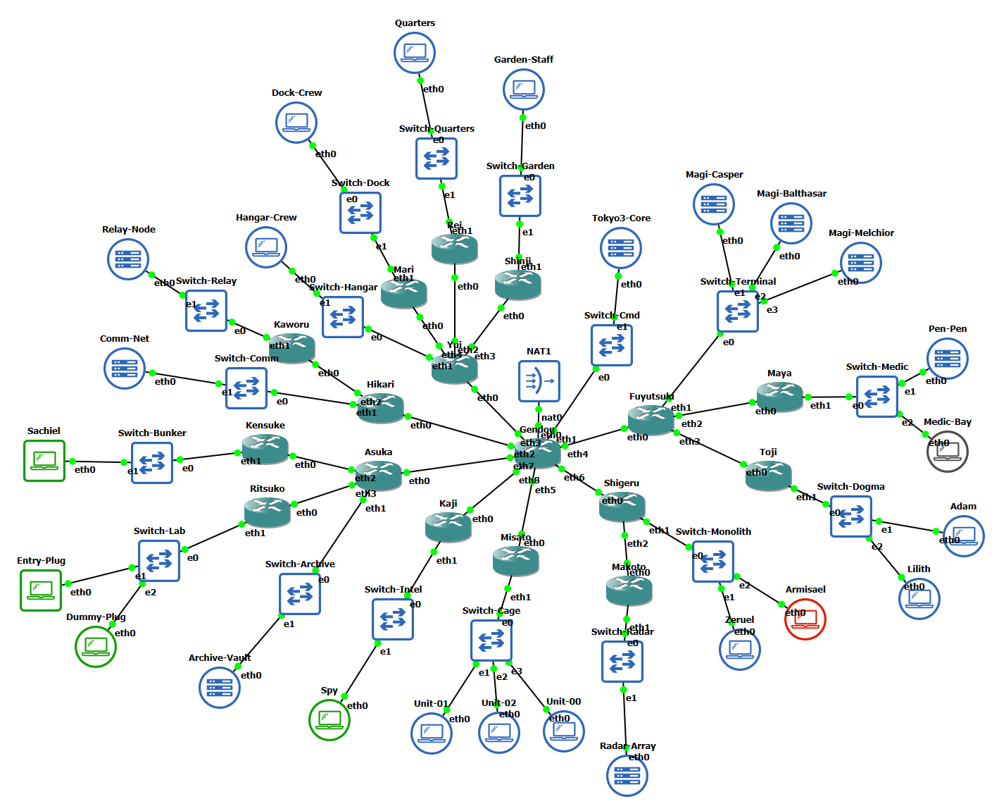
*Gambar 1.1: Desain Topologi Jaringan GNS3 NERV Tokyo-3 (Operation Geofront)*

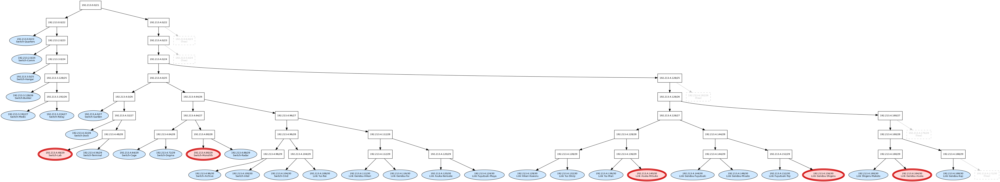
*Gambar 1.2: Diagram Pembagian Alokasi Subnet VLSM (Subnet Tree)*

---

### Soal 1: Identifikasi Perangkat

#### Deskripsi Soal
Mengidentifikasi peran setiap *node* (perangkat) dalam jaringan NERV Geofront, meliputi **Router/Gateway**, **Kategori Node (Pilot, Staf Geofront, Terduga Dummy System, Perangkat MAGI, dan Lainnya)**, serta **Layanan (Listener Service)** dan jumlah host yang dibutuhkan per switch untuk perhitungan subnetting VLSM.

---

#### Langkah Pengerjaan
Kami melakukan analisis berdasarkan kebutuhan skenario *Operation Geofront*:
1. **Router Utama & Gateway:** 
   - **Gendou** bertindak sebagai router pusat dan satu-satunya penghubung ke `NAT1`.
   - 16 router di bawahnya bertindak sebagai gateway bagi masing-masing LAN serta penghubung antar-cabang (*branch* dan *leaf*).
2. **Kategori Node:** Mengelompokkan node berdasarkan peran hak akses dan profil keamanannya (Pilot, Staf Geofront, Terduga Dummy System, Perangkat MAGI, dan Lainnya/Zona Sensitif).
3. **Layanan Jaringan (Listener `nc`):** Mengidentifikasi node-node penyedia layanan TCP port tertentu (seperti superkomputer MAGI, Pen-Pen, dan Tokyo3-Core).
4. **Analisis Kebutuhan Host:** Menghitung total kebutuhan host per switch ditambah 1 IP untuk router gateway (`Host + 1 Gateway`) guna menentukan alokasi subnet VLSM.

---

#### Hasil Identifikasi

##### 1. Identifikasi Router
Jaringan memiliki total **17 Router** dengan peran masing-masing:

| Router | Peran / Deskripsi | Switch / LAN yang Dijaga | Keterangan Koneksi |
| :--- | :--- | :--- | :--- |
| **Gendou** | Router Pusat / NAT Gateway | Switch-Cmd | Satu-satunya yang terhubung ke NAT1 & induk 7 router cabang |
| **Fuyutsuki** | Branch Router | Switch-Terminal | Gateway cluster superkomputer MAGI, induk cabang Maya & Toji |
| **Shigeru** | Branch Router | Switch-Monolith | Gateway Zona Sensitif Monolith, induk cabang Makoto |
| **Asuka** | Branch Router | Switch-Archive | Gateway arsip data, induk cabang Kensuke & Ritsuko |
| **Hikari** | Branch Router | Switch-Comm | Gateway komunikasi pusat, induk cabang Kaworu |
| **Yui** | Branch Router | Switch-Hangar | Gateway divisi hangar, induk cabang Rei, Shinji, & Mari |
| **Rei** | Leaf Router | Switch-Quarters | Gateway asrama personel |
| **Kaworu** | Leaf Router | Switch-Relay | Gateway relay transmisi sinyal, ujung cabang di bawah Hikari |
| **Shinji** | Leaf Router | Switch-Garden | Gateway area staf taman/agro |
| **Kensuke** | Leaf Router | Switch-Bunker | Gateway bunker pertahanan di bawah Asuka |
| **Maya** | Leaf Router | Switch-Medic | Gateway fasilitas medis di bawah Fuyutsuki |
| **Mari** | Leaf Router | Switch-Dock | Gateway fasilitas dock logistik di bawah Yui |
| **Ritsuko** | Leaf Router | Switch-Lab | Gateway laboratorium riset di bawah Asuka |
| **Misato** | Leaf Router | Switch-Cage | Gateway cage penampungan EVA di bawah Gendou |
| **Toji** | Leaf Router | Switch-Dogma | Gateway area Terminal Dogma di bawah Fuyutsuki |
| **Makoto** | Leaf Router | Switch-Radar | Gateway radar array pengawas di bawah Shigeru |
| **Kaji** | Leaf Router | Switch-Intel | Gateway divisi intelijen di bawah Gendou |

##### 2. Identifikasi Kategori Node, Alokasi Host, & Layanan

| No | Switch | Router Gateway | Container & Kebutuhan Host | Kategori Skenario | Layanan / Port TCP (`nc`) |
| :-: | :--- | :--- | :--- | :--- | :--- |
| 1 | **Switch-Quarters** | Rei | Quarters = 500 Host | Lainnya | - |
| 2 | **Switch-Comm** | Hikari | Comm-Net = 200 Host | Lainnya | - |
| 3 | **Switch-Hangar** | Yui | Hangar-Crew = 100 Host | Lainnya | - |
| 4 | **Switch-Bunker** | Kensuke | Sachiel = 55 Host | **Pilot** | - |
| 5 | **Switch-Medic** | Maya | 1. Pen-Pen = 1 Host<br>2. Medic-Bay = 25 Host | Lainnya | **Pen-Pen** (Port 80) |
| 6 | **Switch-Relay** | Kaworu | Relay-Node = 25 Host | Lainnya | - |
| 7 | **Switch-Garden** | Shinji | Garden-Staff = 14 Host | Lainnya | - |
| 8 | **Switch-Dock** | Mari | Dock-Crew = 12 Host | Lainnya | - |
| 9 | **Switch-Lab** | Ritsuko | 1. Entry-Plug = 3 Host<br>2. Dummy-Plug = 2 Host | **Terduga Dummy System** | - |
| 10 | **Switch-Terminal** | Fuyutsuki | 1. Magi-Casper = 1 Host<br>2. Magi-Balthasar = 1 Host<br>3. Magi-Melchior = 1 Host | **Perangkat MAGI** | **Magi-Casper** (Port 5000)<br>**Magi-Balthasar** (Port 5000, 5001)<br>**Magi-Melchior** (Port 5000) |
| 11 | **Switch-Cage** | Misato | 1. Unit-01 = 1 Host<br>2. Unit-02 = 1 Host<br>3. Unit-00 = 1 Host | **Pilot** | - |
| 12 | **Switch-Dogma** | Toji | 1. Lilith = 1 Host<br>2. Adam = 1 Host | **Staf Geofront** | - |
| 13 | **Switch-Monolith** | Shigeru | 1. Zeruel = 1 Host<br>2. Armisael = 1 Host | **Zona Sensitif** / Faksi Terpisah | - |
| 14 | **Switch-Radar** | Makoto | Radar-Array = 4 Host | **Zona Sensitif** | - |
| 15 | **Switch-Archive** | Asuka | Archive-Vault = 1 Host | Lainnya | - |
| 16 | **Switch-Intel** | Kaji | Spy = 1 Host | **Terduga Dummy System** | - |
| 17 | **Switch-Cmd** | Gendou | Tokyo3-Core = 1 Host | Core Command | **Tokyo3-Core** (Port 80, 8080) |

> **Catatan Alamat Node:**
> Sesuai aturan glosarium, gateway router memegang IP usable pertama subnet. Node-node pada switch yang sama diberi IP usable berikutnya urut dari penulisan nama di diagram (kiri ke kanan).

---

#### Validasi
Validasi peran dan posisi perangkat dilakukan dengan mencocokkan konfigurasi topologi GNS3 pada [`assets/topologi.png`](assets/topologi.png) dengan hierarki subnetting pada [`out/tree.png`](out/tree.png) serta berkas konfigurasi [`out/hasil.md`](out/hasil.md):
- **Router Gendou** berada di posisi root sebagai *Default Gateway* menuju dunia luar / Internet (`NAT1`).
- Semua faksi kritis teridentifikasi dengan jelas:
  - Superkomputer MAGI terpusat pada **Switch-Terminal** (Router Fuyutsuki).
  - Titik infeksi Armisael teridentifikasi berada di **Switch-Monolith** berdampingan dengan Zeruel di bawah Router Shigeru.
  - Komponen Dummy System teridentifikasi berada di **Switch-Lab** (Entry-Plug, Dummy-Plug) dan **Switch-Intel** (Spy).
- Seluruh 17 antarmuka router dan 25 node faksi telah dikonfigurasikan secara presisi pada direktori [`out/interfaces/`](out/interfaces/) dan skrip perutean pada direktori [`out/route-scripts/`](out/route-scripts/).

---

### Soal 2: Konfigurasi Interface Router, IP Forwarding, dan Uji Ping P2P Link

#### Deskripsi Soal
Mengonfigurasi pengalamatan IP (*IP Addressing*) pada seluruh *interface* di 17 router sesuai hasil perhitungan VLSM Soal 1, mengaktifkan mekanisme *IP forwarding* (`net.ipv4.ip_forward=1`) pada setiap router, mengonfigurasi Router Gendou sebagai satu-satunya *node* yang memperoleh koneksi internet/DHCP dari NAT1, serta melakukan validasi konektivitas *Point-to-Point* (P2P) link antar-router yang bertetangga langsung (*direct link ping*).

---

#### Langkah Pengerjaan
1. **Konfigurasi Interface Router (`/etc/network/interfaces`):**
   - **Gendou:** Interface `eth0` dikonfigurasi menggunakan mode `dhcp` untuk terhubung ke NAT1. Interface lainnya (`eth1` s/d `eth8`) diberikan alamat IP static sesuai pembagian subnet LAN dan link antar-router.
   - **16 Router Lainnya:** Setiap interface LAN diberikan alamat IP usable pertama (sebagai gateway LAN), dan interface uplink/downlink diberikan alamat IP `/30` sesuai alokasi VLSM link P2P.
2. **Aktivasi IP Forwarding:**
   - Menjalankan perintah `sysctl -w net.ipv4.ip_forward=1` (atau memastikan `net.ipv4.ip_forward=1` aktif di `/etc/sysctl.conf`) pada seluruh 17 router agar dapat meneruskan paket data antar-subnet.
3. **Pemeriksaan Alamat Interface (`ip -br a`):**
   - Menjalankan `ip -br a` pada setiap router untuk memverifikasi bahwa interface telah berstatus `UP` dan mengikat alamat IP serta netmask yang benar.
4. **Pengujian Ping Link Router-to-Router:**
   - Menjalankan uji ping dari router induk/cabang ke IP tetangga pada ujung link yang sama (*direct hop*) untuk memastikan layer 1 dan layer 2 GNS3 terhubung sempurna sebelum rute statis dipasang.

---

#### Tabel Alokasi IP Interface Router

| Router | Interface | Alamat IP & Prefix | Terhubung ke |
| :--- | :--- | :--- | :--- |
| **Gendou** | `eth0`<br>`eth1`<br>`eth2`<br>`eth3`<br>`eth4`<br>`eth5`<br>`eth6`<br>`eth7`<br>`eth8` | DHCP (NAT1)<br>`192.213.4.105/30`<br>`192.213.4.113/30`<br>`192.213.4.117/30`<br>`192.213.4.145/30`<br>`192.213.4.149/30`<br>`192.213.4.157/30`<br>`192.213.4.165/30`<br>`192.213.4.169/30` | NAT1 Gateway (Internet)<br>Switch-Cmd (Gateway Tokyo3-Core)<br>Link ke Router Hikari (`192.213.4.114`)<br>Link ke Router Yui (`192.213.4.118`)<br>Link ke Router Fuyutsuki (`192.213.4.146`)<br>Link ke Router Misato (`192.213.4.150`)<br>Link ke Router Shigeru (`192.213.4.158`)<br>Link ke Router Asuka (`192.213.4.166`)<br>Link ke Router Kaji (`192.213.4.170`) |
| **Yui** | `eth0`<br>`eth1`<br>`eth2`<br>`eth3`<br>`eth4` | `192.213.4.118/30`<br>`192.213.3.1/25`<br>`192.213.4.109/30`<br>`192.213.4.133/30`<br>`192.213.4.137/30` | Uplink ke Gendou (`192.213.4.117`)<br>Switch-Hangar (Gateway Hangar-Crew)<br>Link ke Router Rei (`192.213.4.110`)<br>Link ke Router Shinji (`192.213.4.134`)<br>Link ke Router Mari (`192.213.4.138`) |
| **Fuyutsuki** | `eth0`<br>`eth1`<br>`eth2`<br>`eth3` | `192.213.4.146/30`<br>`192.213.4.57/29`<br>`192.213.4.125/30`<br>`192.213.4.153/30` | Uplink ke Gendou (`192.213.4.145`)<br>Switch-Terminal (Gateway MAGI)<br>Link ke Router Maya (`192.213.4.126`)<br>Link ke Router Toji (`192.213.4.154`) |
| **Asuka** | `eth0`<br>`eth1`<br>`eth2`<br>`eth3` | `192.213.4.166/30`<br>`192.213.4.97/30`<br>`192.213.4.121/30`<br>`192.213.4.141/30` | Uplink ke Gendou (`192.213.4.165`)<br>Switch-Archive (Gateway Archive-Vault)<br>Link ke Router Kensuke (`192.213.4.122`)<br>Link ke Router Ritsuko (`192.213.4.142`) |
| **Hikari** | `eth0`<br>`eth1`<br>`eth2` | `192.213.4.114/30`<br>`192.213.2.1/24`<br>`192.213.4.129/30` | Uplink ke Gendou (`192.213.4.113`)<br>Switch-Comm (Gateway Comm-Net)<br>Link ke Router Kaworu (`192.213.4.130`) |
| **Shigeru** | `eth0`<br>`eth1`<br>`eth2` | `192.213.4.158/30`<br>`192.213.4.81/29`<br>`192.213.4.161/30` | Uplink ke Gendou (`192.213.4.157`)<br>Switch-Monolith (Gateway Monolith)<br>Link ke Router Makoto (`192.213.4.162`) |
| **Rei** | `eth0`<br>`eth1` | `192.213.4.110/30`<br>`192.213.0.1/23` | Uplink ke Yui (`192.213.4.109`)<br>Switch-Quarters (Gateway Quarters) |
| **Kaworu** | `eth0`<br>`eth1` | `192.213.4.130/30`<br>`192.213.3.225/27` | Uplink ke Hikari (`192.213.4.129`)<br>Switch-Relay (Gateway Relay-Node) |
| **Shinji** | `eth0`<br>`eth1` | `192.213.4.134/30`<br>`192.213.4.1/27` | Uplink ke Yui (`192.213.4.133`)<br>Switch-Garden (Gateway Garden-Staff) |
| **Kensuke** | `eth0`<br>`eth1` | `192.213.4.122/30`<br>`192.213.3.129/26` | Uplink ke Asuka (`192.213.4.121`)<br>Switch-Bunker (Gateway Sachiel) |
| **Maya** | `eth0`<br>`eth1` | `192.213.4.126/30`<br>`192.213.3.193/27` | Uplink ke Fuyutsuki (`192.213.4.125`)<br>Switch-Medic (Gateway Medic-Bay, Pen-Pen) |
| **Mari** | `eth0`<br>`eth1` | `192.213.4.138/30`<br>`192.213.4.33/28` | Uplink ke Yui (`192.213.4.137`)<br>Switch-Dock (Gateway Dock-Crew) |
| **Ritsuko** | `eth0`<br>`eth1` | `192.213.4.142/30`<br>`192.213.4.49/29` | Uplink ke Asuka (`192.213.4.141`)<br>Switch-Lab (Gateway Lab) |
| **Misato** | `eth0`<br>`eth1` | `192.213.4.150/30`<br>`192.213.4.65/29` | Uplink ke Gendou (`192.213.4.149`)<br>Switch-Cage (Gateway Unit EVA) |
| **Toji** | `eth0`<br>`eth1` | `192.213.4.154/30`<br>`192.213.4.73/29` | Uplink ke Fuyutsuki (`192.213.4.153`)<br>Switch-Dogma (Gateway Dogma) |
| **Makoto** | `eth0`<br>`eth1` | `192.213.4.162/30`<br>`192.213.4.89/29` | Uplink ke Shigeru (`192.213.4.161`)<br>Switch-Radar (Gateway Radar-Array) |
| **Kaji** | `eth0`<br>`eth1` | `192.213.4.170/30`<br>`192.213.4.101/30` | Uplink ke Gendou (`192.213.4.169`)<br>Switch-Intel (Gateway Spy) |

---

#### Hasil dan Dokumentasi Pengujian

##### 1. Dokumentasi Pemeriksaan Interface (`ip -br a`)
Pemeriksaan antarmuka dilakukan pada seluruh **17 Router** untuk memverifikasi bahwa seluruh *interface* (baik interface LAN maupun link *point-to-point*) telah berstatus `UP` dan mengikat alamat IP serta netmask yang sesuai:

| No | Router | Dokumentasi `ip -br a` | Keterangan Interface & Status |
| :-: | :--- | :---: | :--- |
| 1 | **Gendou** | 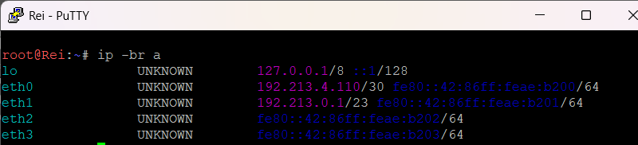 | `eth0` DHCP (NAT1), `eth1` s/d `eth8` UP |
| 2 | **Hikari** | 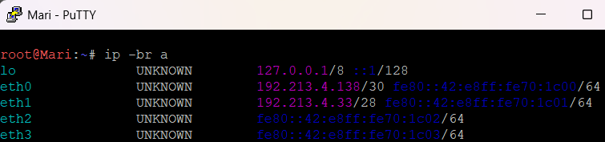 | `eth0` uplink, `eth1` LAN Comm, `eth2` link Kaworu UP |
| 3 | **Shinji** | 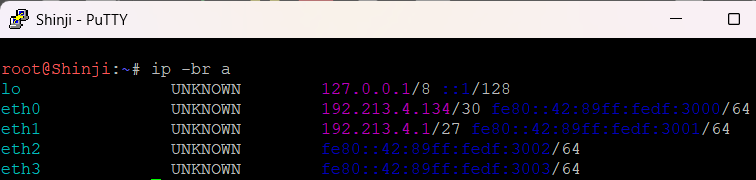 | `eth0` uplink Yui, `eth1` LAN Garden UP |
| 4 | **Kaworu** | 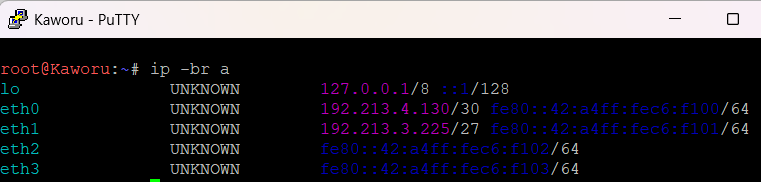 | `eth0` uplink Hikari, `eth1` LAN Relay UP |
| 5 | **Yui** | 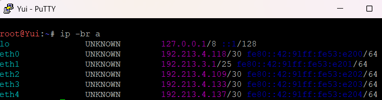 | `eth0` uplink Gendou, `eth1` LAN Hangar, `eth2`-`eth4` UP |
| 6 | **Maya** | 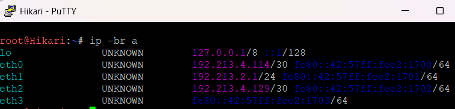 | `eth0` uplink Fuyutsuki, `eth1` LAN Medic UP |
| 7 | **Mari** | 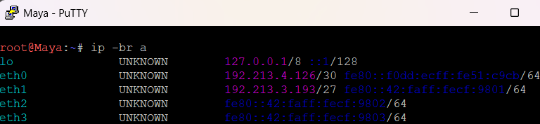 | `eth0` uplink Yui, `eth1` LAN Dock UP |
| 8 | **Fuyutsuki** | 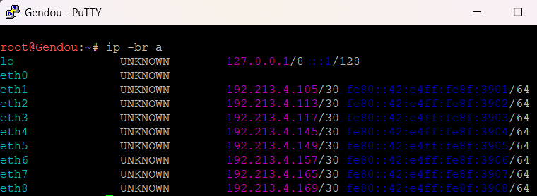 | `eth0` uplink Gendou, `eth1` LAN MAGI, `eth2`-`eth3` UP |
| 9 | **Ritsuko** | 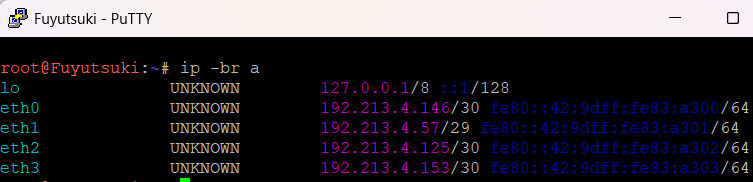 | `eth0` uplink Asuka, `eth1` LAN Lab UP |
| 10 | **Kensuke** | 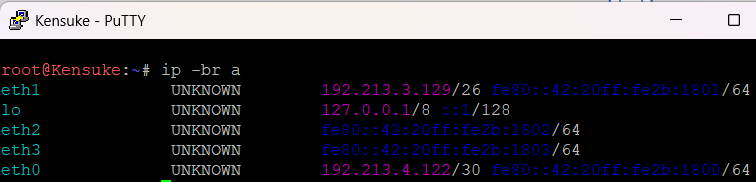 | `eth0` uplink Asuka, `eth1` LAN Bunker UP |
| 11 | **Asuka** | 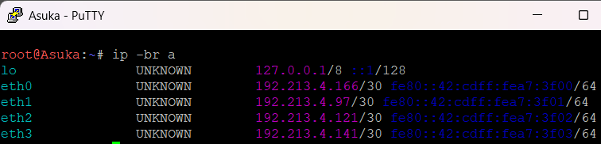 | `eth0` uplink Gendou, `eth1` LAN Archive, `eth2`-`eth3` UP |
| 12 | **Shigeru** | 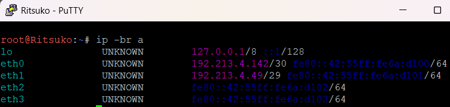 | `eth0` uplink Gendou, `eth1` LAN Monolith, `eth2` link Makoto UP |
| 13 | **Kaji** | 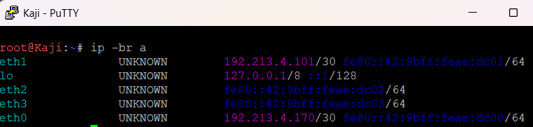 | `eth0` uplink Gendou, `eth1` LAN Intel UP |
| 14 | **Misato** | 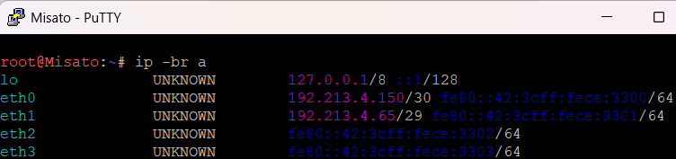 | `eth0` uplink Gendou, `eth1` LAN Cage UP |
| 15 | **Makoto** | 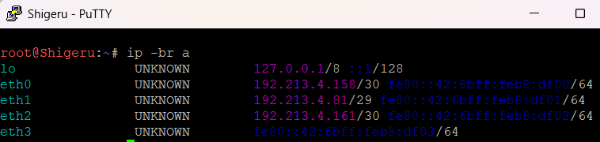 | `eth0` uplink Shigeru, `eth1` LAN Radar UP |
| 16 | **Toji** | 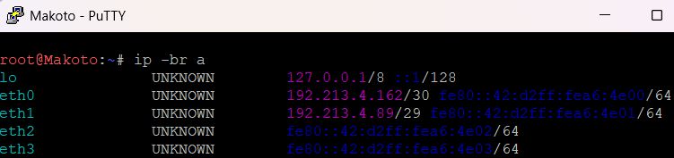 | `eth0` uplink Fuyutsuki, `eth1` LAN Dogma UP |
| 17 | **Rei** | 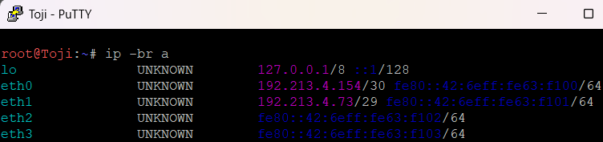 | `eth0` uplink Yui, `eth1` LAN Quarters UP |

---

##### 2. Pengujian Ping P2P Link Antar-Router
Pengujian ping dilakukan pada kedua ujung setiap link *Point-to-Point* antar-router langsung:

1. **Uji Ping dari Router Gendou ke 7 Router Cabang:**
   ```bash
   for ip in 192.213.4.114 192.213.4.118 192.213.4.146 192.213.4.150 192.213.4.158 192.213.4.166 192.213.4.170; do
       ping -c 2 -W 1 $ip
   done
   ```
   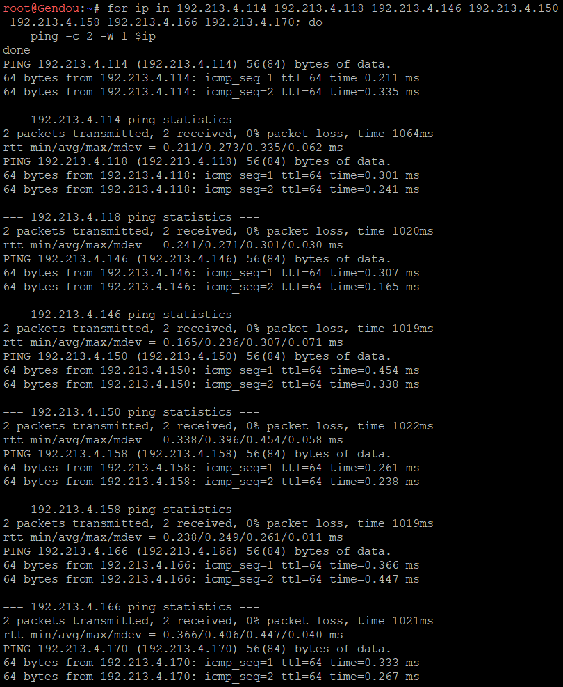  
   *Gambar 2.2: Hasil Ping dari Router Gendou ke Hikari, Yui, Fuyutsuki, Misato, Shigeru, Asuka, dan Kaji (0% packet loss)*

2. **Uji Ping dari Router Yui ke 3 Router di Bawahnya:**
   ```bash
   for ip in 192.213.4.110 192.213.4.134 192.213.4.138; do
       ping -c 2 -W 1 $ip
   done
   ```
   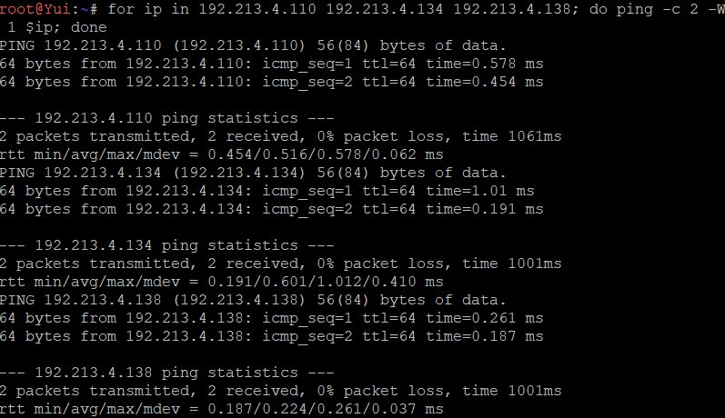  
   *Gambar 2.3: Hasil Ping dari Router Yui ke Rei, Shinji, dan Mari (0% packet loss)*

3. **Uji Ping dari Router Fuyutsuki ke 2 Router di Bawahnya:**
   ```bash
   for ip in 192.213.4.126 192.213.4.154; do
       ping -c 2 -W 1 $ip
   done
   ```
   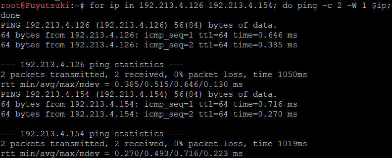  
   *Gambar 2.4: Hasil Ping dari Router Fuyutsuki ke Maya dan Toji (0% packet loss)*

4. **Uji Ping dari Router Asuka ke 2 Router di Bawahnya:**
   ```bash
   for ip in 192.213.4.122 192.213.4.142; do
       ping -c 2 -W 1 $ip
   done
   ```
   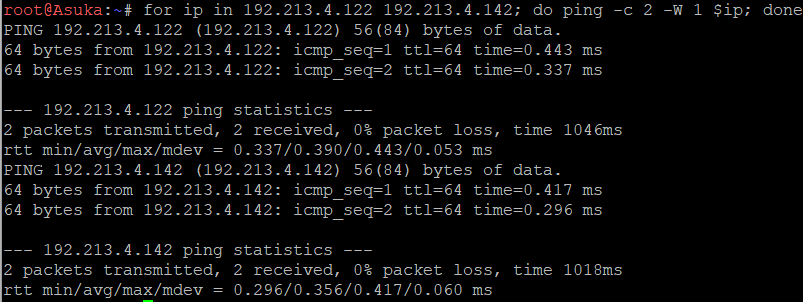  
   *Gambar 2.5: Hasil Ping dari Router Asuka ke Kensuke dan Ritsuko (0% packet loss)*

5. **Uji Ping dari Router Hikari ke Router Kaworu:**
   ```bash
   ping -c 2 -W 1 192.213.4.130
   ```
   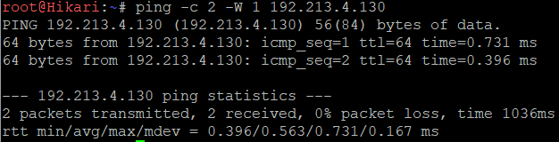  
   *Gambar 2.6: Hasil Ping dari Router Hikari ke Router Kaworu (0% packet loss)*

6. **Uji Ping dari Router Shigeru ke Router Makoto:**
   ```bash
   ping -c 2 -W 1 192.213.4.162
   ```
   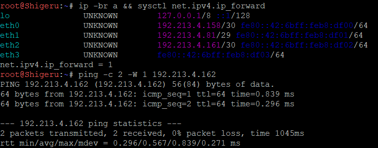  
   *Gambar 2.7: Hasil Ping dari Router Shigeru ke Router Makoto (0% packet loss)*

---

#### Validasi
- Seluruh pengujian ping *direct hop* menghasilkan `0% packet loss`, menandakan konfigurasi interface `/30` dan kabel virtual pada GNS3 telah terpasang dengan tepat.
- Konfigurasi `net.ipv4.ip_forward=1` telah diaktifkan di seluruh router, menyiapkan fondasi untuk konfigurasi rute statis pada soal berikutnya.


---

### Soal 3: Routing Statis Antar-Subnet

#### Deskripsi Soal

Menghubungkan seluruh subnet Geofront dengan routing statis menggunakan rute sesedikit mungkin. Aturan:
- **Gendou** memakai default route ke NAT1 (dari DHCP) dan rute spesifik ke setiap cabang di bawahnya.
- **Router lain** cukup punya satu default route ke upstream dan rute spesifik untuk subnet di bawahnya.
- Subnet satu cabang yang dapat digabungkan tepat menjadi satu CIDR **harus diringkas**.
- Untuk pengujian soal 3–5, node uji (Armisael, Sachiel, Lilith, Comm-Net) diberi IP sementara sesuai tabel VLSM.

---

#### Ringkasan CIDR yang Diterapkan

Dari 33 subnet (17 LAN + 16 link), terdapat satu pasang subnet pada cabang Shigeru yang dapat diringkas secara tepat:

| Subnet Asal | Keterangan |
|---|---|
| `192.213.4.80/29` | Switch-Monolith (Shigeru) |
| `192.213.4.88/29` | Switch-Radar (Makoto) |
| **→ `192.213.4.80/28`** | **Ringkasan CIDR yang mencakup keduanya** |

Kedua subnet /29 ini bersebelahan dan berprefix identik pada 28 bit pertama, sehingga dapat diringkas menjadi `/28`. Subnet lainnya tidak dapat diringkas karena blok gabungannya akan tumpang tindih dengan subnet cabang lain.

---

#### Tabel Rute Statis Per Router

**Gendou (Router Pusat — 8 cabang downstream)**

| Tujuan | Next-hop (IP) | Via Router |
|---|---|---|
| `default` | *(DHCP dari NAT1)* | NAT1 |
| `192.213.2.0/24` | `192.213.4.113` | Hikari |
| `192.213.3.224/27` | `192.213.4.113` | Hikari |
| `192.213.4.128/30` | `192.213.4.113` | Hikari |
| `192.213.0.0/23` | `192.213.4.117` | Yui |
| `192.213.3.0/25` | `192.213.4.117` | Yui |
| `192.213.4.0/27` | `192.213.4.117` | Yui |
| `192.213.4.32/28` | `192.213.4.117` | Yui |
| `192.213.4.108/30` | `192.213.4.117` | Yui |
| `192.213.4.132/30` | `192.213.4.117` | Yui |
| `192.213.4.136/30` | `192.213.4.117` | Yui |
| `192.213.3.192/27` | `192.213.4.145` | Fuyutsuki |
| `192.213.4.56/29` | `192.213.4.145` | Fuyutsuki |
| `192.213.4.72/29` | `192.213.4.145` | Fuyutsuki |
| `192.213.4.124/30` | `192.213.4.145` | Fuyutsuki |
| `192.213.4.152/30` | `192.213.4.145` | Fuyutsuki |
| `192.213.4.64/29` | `192.213.4.149` | Misato |
| `192.213.4.80/28` *(ringkasan)* | `192.213.4.157` | Shigeru |
| `192.213.4.160/30` | `192.213.4.157` | Shigeru |
| `192.213.3.128/26` | `192.213.4.165` | Asuka |
| `192.213.4.48/29` | `192.213.4.165` | Asuka |
| `192.213.4.96/30` | `192.213.4.165` | Asuka |
| `192.213.4.120/30` | `192.213.4.165` | Asuka |
| `192.213.4.140/30` | `192.213.4.165` | Asuka |
| `192.213.4.100/30` | `192.213.4.169` | Kaji |

**Router Cabang (default route upstream + rute downstream)**

| Router | Default via | Rute Tambahan (downstream) |
|---|---|---|
| Hikari | `192.213.4.113` (Gendou) | `192.213.3.224/27` via `192.213.4.129` (Kaworu) |
| Yui | `192.213.4.117` (Gendou) | `192.213.0.0/23` via `192.213.4.109` (Rei); `192.213.4.0/27` via `192.213.4.133` (Shinji); `192.213.4.32/28` via `192.213.4.137` (Mari) |
| Fuyutsuki | `192.213.4.145` (Gendou) | `192.213.3.192/27` via `192.213.4.125` (Maya); `192.213.4.72/29` via `192.213.4.153` (Toji) |
| Shigeru | `192.213.4.157` (Gendou) | `192.213.4.88/29` via `192.213.4.161` (Makoto) |
| Asuka | `192.213.4.165` (Gendou) | `192.213.3.128/26` via `192.213.4.121` (Kensuke); `192.213.4.48/29` via `192.213.4.141` (Ritsuko) |
| Misato | `192.213.4.149` (Gendou) | *(tidak ada — Cage adalah leaf)* |
| Kaji | `192.213.4.169` (Gendou) | *(tidak ada — Intel adalah leaf)* |
| Rei | `192.213.4.109` (Yui) | *(tidak ada — Quarters adalah leaf)* |
| Kaworu | `192.213.4.129` (Hikari) | *(tidak ada — Relay adalah leaf)* |
| Shinji | `192.213.4.133` (Yui) | *(tidak ada — Garden adalah leaf)* |
| Mari | `192.213.4.137` (Yui) | *(tidak ada — Dock adalah leaf)* |
| Maya | `192.213.4.125` (Fuyutsuki) | *(tidak ada — Medic adalah leaf)* |
| Toji | `192.213.4.153` (Fuyutsuki) | *(tidak ada — Dogma adalah leaf)* |
| Makoto | `192.213.4.161` (Shigeru) | *(tidak ada — Radar adalah leaf)* |
| Kensuke | `192.213.4.121` (Asuka) | *(tidak ada — Bunker adalah leaf)* |
| Ritsuko | `192.213.4.141` (Asuka) | *(tidak ada — Lab adalah leaf)* |

---

#### Script Konfigurasi Rute Statis

Rute dikonfigurasi menggunakan perintah `ip route replace` agar idempoten (aman dijalankan ulang). Contoh script Gendou:

```bash
#!/bin/sh
sysctl -w net.ipv4.ip_forward=1
# Cabang Hikari
ip route replace 192.213.2.0/24    via 192.213.4.113
ip route replace 192.213.3.224/27  via 192.213.4.113
ip route replace 192.213.4.128/30  via 192.213.4.113
# Cabang Yui
ip route replace 192.213.0.0/23    via 192.213.4.117
ip route replace 192.213.3.0/25    via 192.213.4.117
ip route replace 192.213.4.0/27    via 192.213.4.117
ip route replace 192.213.4.32/28   via 192.213.4.117
ip route replace 192.213.4.108/30  via 192.213.4.117
ip route replace 192.213.4.132/30  via 192.213.4.117
ip route replace 192.213.4.136/30  via 192.213.4.117
# Cabang Fuyutsuki
ip route replace 192.213.3.192/27  via 192.213.4.145
ip route replace 192.213.4.56/29   via 192.213.4.145
ip route replace 192.213.4.72/29   via 192.213.4.145
ip route replace 192.213.4.124/30  via 192.213.4.145
ip route replace 192.213.4.152/30  via 192.213.4.145
# Cabang Misato
ip route replace 192.213.4.64/29   via 192.213.4.149
# Cabang Shigeru (dengan ringkasan CIDR)
ip route replace 192.213.4.80/28   via 192.213.4.157
ip route replace 192.213.4.160/30  via 192.213.4.157
# Cabang Asuka
ip route replace 192.213.3.128/26  via 192.213.4.165
ip route replace 192.213.4.48/29   via 192.213.4.165
ip route replace 192.213.4.96/30   via 192.213.4.165
ip route replace 192.213.4.120/30  via 192.213.4.165
ip route replace 192.213.4.140/30  via 192.213.4.165
# Cabang Kaji
ip route replace 192.213.4.100/30  via 192.213.4.169
```

---

#### Pembuktian: Armisael Ping ke Tiga Subnet

IP sementara Armisael: `192.213.4.83/29`, gateway `192.213.4.81` (Shigeru).

**1. Ping dari Armisael ke Lilith (`192.213.4.74`) — Switch-Dogma via Fuyutsuki**

```bash
ping -c 3 192.213.4.74
```

**2. Ping dari Armisael ke Sachiel (`192.213.3.130`) — Switch-Bunker via Asuka**

```bash
ping -c 3 192.213.3.130
```

**3. Ping dari Armisael ke Comm-Net (`192.213.2.2`) — Switch-Comm via Hikari**

```bash
ping -c 3 192.213.2.2
```

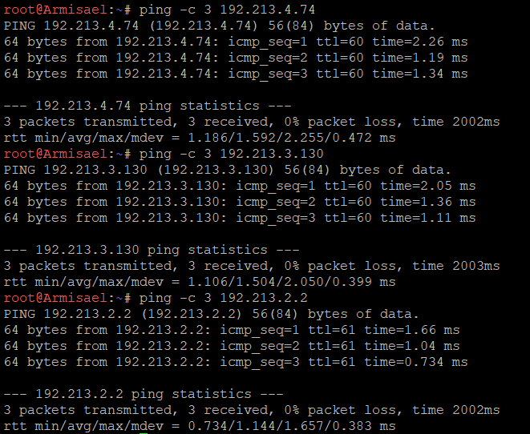  
*Gambar 3.1: Armisael berhasil ping ke Lilith (192.213.4.74), Sachiel (192.213.3.130), dan Comm-Net (192.213.2.2) — seluruh ping berhasil tanpa packet loss.*

---

#### Validasi

- Seluruh 17 router telah dikonfigurasi dengan routing statis yang sesuai.
- Gendou menggunakan default route via NAT1 (DHCP) dan 24 rute spesifik ke cabang di bawahnya.
- Router leaf (Rei, Kaworu, Shinji, Mari, Maya, Toji, Makoto, Kensuke, Ritsuko, Misato, Kaji) hanya membutuhkan satu default route ke upstream.
- Subnet Switch-Monolith (`/29`) dan Switch-Radar (`/29`) berhasil diringkas menjadi `192.213.4.80/28` pada rute Gendou → Shigeru.
- Ketiga ping dari Armisael menunjukkan konektivitas penuh antar-subnet lintas cabang router (0% packet loss).

---

### Soal 4: Akses Internet dan NAT

#### Deskripsi Soal

Seluruh jaringan internal perlu mengakses internet melalui Gendou dan NAT1. Alamat IP sisi NAT1 dapat berubah, sehingga translasi alamat menggunakan `MASQUERADE` pada interface keluar `eth0`, bukan alamat IP statis. Rule dibatasi hanya untuk paket dari prefix internal `192.213.0.0/21` yang keluar melalui NAT1; trafik antar-LAN tidak cocok dengan rule ini dan tetap menggunakan alamat sumber aslinya.

#### Konfigurasi Gendou

Pastikan Gendou meneruskan paket dan memiliki default route yang diperoleh dari NAT1 melalui DHCP. Kemudian pasang `iptables` dan tambahkan rule NAT:

```bash
sysctl -w net.ipv4.ip_forward=1
apt-get update && apt-get install -y iptables
iptables -t nat -F POSTROUTING
iptables -t nat -A POSTROUTING -s 192.213.0.0/21 -o eth0 -j MASQUERADE
```

`MASQUERADE` mengambil alamat terkini dari `eth0`, sehingga rule tidak perlu diubah ketika alamat NAT1 berganti. Kondisi `-s 192.213.0.0/21` dan `-o eth0` membatasi translasi pada trafik internal yang menuju internet. `iptables -t nat -F POSTROUTING` mengosongkan rule POSTROUTING yang sudah ada sebelum rule ini dipasang.

Jika Gendou tidak mendapat alamat atau rute dari NAT1 secara otomatis, konfigurasi berikut dapat digunakan sebagai pemulihan sementara, hanya jika alamat tersebut sesuai dengan NAT1:

```bash
ip addr add 192.168.122.100/24 dev eth0
ip route replace default via 192.168.122.1
echo "nameserver 8.8.8.8" > /etc/resolv.conf
ping -c 2 8.8.8.8
```

Alamat dan gateway pada langkah pemulihan bersifat spesifik untuk jaringan NAT tersebut. Ini bukan bagian dari konfigurasi dinamis utama; setelah konektivitas tersedia, rule `MASQUERADE` tetap menggunakan alamat aktif `eth0`.

#### DNS pada Node Pengujian

Agar nama domain dapat di-resolve, jalankan perintah berikut pada setiap node yang perlu mengakses layanan berbasis nama atau memasang paket. Perintah ini juga diterapkan pada Armisael dan Lilith untuk pengujian:

```bash
echo "nameserver 8.8.8.8" > /etc/resolv.conf
```

#### Pembuktian Konektivitas

Pengujian dari Armisael:

```bash
ping -c 3 8.8.8.8
ping -c 3 deb.debian.org
```

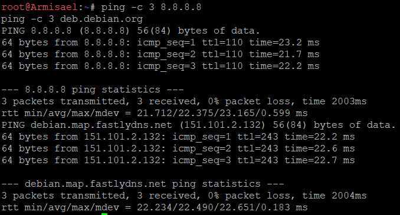  
*Gambar 4.1: Armisael berhasil ping ke `8.8.8.8` dan `deb.debian.org`, keduanya dengan 0% packet loss.*

Pengujian dari Lilith:

```bash
ping -c 3 8.8.8.8
ping -c 3 deb.debian.org
```

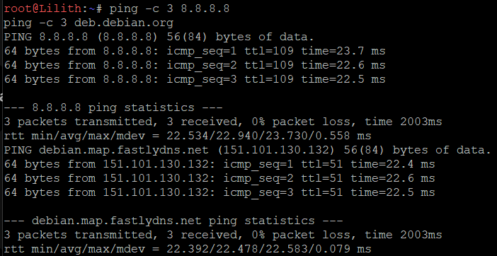  
*Gambar 4.2: Lilith berhasil ping ke `8.8.8.8` dan `deb.debian.org`, keduanya dengan 0% packet loss.*

#### Counter Rule NAT

Periksa rule dan counter paket/byte pada Gendou:

```bash
iptables -t nat -L POSTROUTING -n -v
```

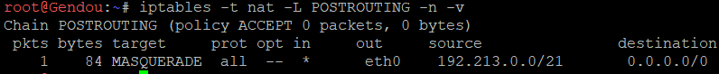  
*Gambar 4.3: Rule `MASQUERADE` untuk sumber `192.213.0.0/21` yang keluar melalui `eth0`; counter saat tangkapan menunjukkan 1 paket / 84 byte.*

Counter bertambah ketika trafik internal keluar melalui NAT1. Dengan demikian, trafik antar-LAN tidak ikut terjemahkan oleh rule ini, sementara pengujian ping berbasis IP dan nama domain berhasil dari kedua node.

---

### Soal 5: Firewall Gendou

#### Deskripsi Soal

Gendou menjadi pintu keluar jaringan, tetapi koneksi baru dari NAT1 tidak boleh masuk. Policy `INPUT` dan `FORWARD` ditetapkan ke `DROP`, lalu rule hanya membuka kebutuhan jaringan:

| Chain | Trafik yang diizinkan |
|---|---|
| `INPUT` | Loopback, koneksi `ESTABLISHED,RELATED`, balasan DHCP dari NAT1 di `eth0`, dan trafik dari prefix internal ke Gendou |
| `FORWARD` | Koneksi `ESTABLISHED,RELATED`, trafik prefix internal keluar melalui `eth0`, dan trafik antar-subnet internal |
| `OUTPUT` | Tetap `ACCEPT` agar koneksi keluar Gendou, termasuk DHCP, dapat berjalan |

Rule forwarding internet dari Soal 4 tetap berada di chain `nat`; policy firewall tidak menghapusnya. Trafik antar-LAN diteruskan tanpa NAT karena rule `MASQUERADE` hanya mencocokkan paket yang keluar melalui `eth0`.

#### Konfigurasi Terpadu Gendou

Konfigurasi Soal 2–5 disatukan dalam [`gendo.sh`](gendo.sh). Jalankan sebagai root di Gendou:

```bash
sh gendo.sh
```

Skrip mempertahankan DHCP dan default route NAT1 pada `eth0`, mengaktifkan IP forwarding, memasang alamat interface internal dan rute statis Gendou, mempertahankan rule `MASQUERADE` Soal 4, lalu menyusun ulang chain filter `INPUT` dan `FORWARD`. Pastikan `iptables` sudah terpasang sebelum menjalankan skrip.

#### Pemeriksaan Rule Firewall

Tampilkan rule filter dan NAT pada Gendou:

```bash
iptables -S
iptables -t nat -S
```

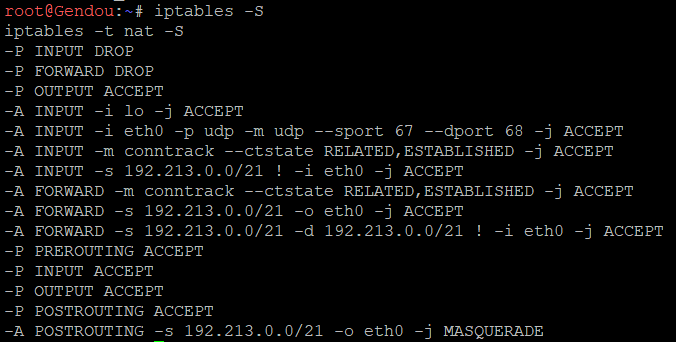  
*Gambar 5.1: Output `iptables -S` dan `iptables -t nat -S` di Gendou menunjukkan policy `INPUT`/`FORWARD` `DROP`, izin forwarding internal, dan rule `MASQUERADE`.*

#### Pembuktian Konektivitas

Dari Armisael, uji akses internet dan konektivitas antar-LAN ke Lilith:

```bash
ping -c 3 8.8.8.8
ping -c 3 192.213.4.74
```

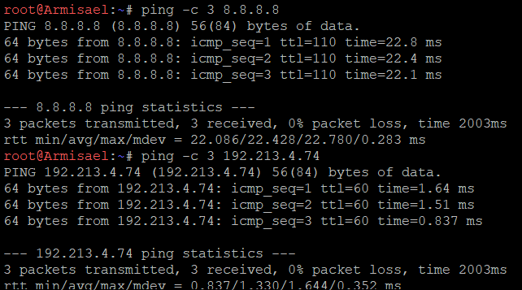  
*Gambar 5.2: Ping Armisael ke `8.8.8.8` dan Lilith (`192.213.4.74`) berhasil dengan 0% packet loss; akses internet dan antar-LAN tetap berjalan setelah firewall diterapkan.*

---

### Soal 6: IP Statis dan Gateway Node

#### Deskripsi Soal

Setiap node non-router dikonfigurasi dengan IP statis dan default gateway sesuai tabel VLSM/glosarium. Gateway router menggunakan alamat usable pertama pada subnet LAN, sedangkan node mendapatkan alamat berikutnya sesuai urutan alokasi. Konfigurasi disimpan pada `/etc/network/interfaces` agar tetap berlaku setelah node di-restart.

#### Daftar IP dan Gateway

| Node | IP statis | Gateway | Switch |
|---|---|---|---|
| Quarters | `192.213.0.2/23` | `192.213.0.1` | Switch-Quarters |
| Comm-Net | `192.213.2.2/24` | `192.213.2.1` | Switch-Comm |
| Hangar-Crew | `192.213.3.2/25` | `192.213.3.1` | Switch-Hangar |
| Sachiel | `192.213.3.130/26` | `192.213.3.129` | Switch-Bunker |
| Medic-Bay | `192.213.3.194/27` | `192.213.3.193` | Switch-Medic |
| Pen-Pen | `192.213.3.195/27` | `192.213.3.193` | Switch-Medic |
| Relay-Node | `192.213.3.226/27` | `192.213.3.225` | Switch-Relay |
| Garden-Staff | `192.213.4.2/27` | `192.213.4.1` | Switch-Garden |
| Dock-Crew | `192.213.4.34/28` | `192.213.4.33` | Switch-Dock |
| Entry-Plug | `192.213.4.50/29` | `192.213.4.49` | Switch-Lab |
| Dummy-Plug | `192.213.4.51/29` | `192.213.4.49` | Switch-Lab |
| Magi-Casper | `192.213.4.58/29` | `192.213.4.57` | Switch-Terminal |
| Magi-Balthasar | `192.213.4.59/29` | `192.213.4.57` | Switch-Terminal |
| Magi-Melchior | `192.213.4.60/29` | `192.213.4.57` | Switch-Terminal |
| Unit-01 | `192.213.4.66/29` | `192.213.4.65` | Switch-Cage |
| Unit-02 | `192.213.4.67/29` | `192.213.4.65` | Switch-Cage |
| Unit-00 | `192.213.4.68/29` | `192.213.4.65` | Switch-Cage |
| Lilith | `192.213.4.74/29` | `192.213.4.73` | Switch-Dogma |
| Adam | `192.213.4.75/29` | `192.213.4.73` | Switch-Dogma |
| Zeruel | `192.213.4.82/29` | `192.213.4.81` | Switch-Monolith |
| Armisael | `192.213.4.83/29` | `192.213.4.81` | Switch-Monolith |
| Radar-Array | `192.213.4.90/29` | `192.213.4.89` | Switch-Radar |
| Archive-Vault | `192.213.4.98/30` | `192.213.4.97` | Switch-Archive |
| Spy | `192.213.4.102/30` | `192.213.4.101` | Switch-Intel |
| Tokyo3-Core | `192.213.4.106/30` | `192.213.4.105` | Switch-Cmd |

#### Konfigurasi Persisten

Pada setiap node, sesuaikan konfigurasi interface LAN di `/etc/network/interfaces` dengan nilai pada tabel. Contoh konfigurasi Unit-01:

```text
auto eth0
iface eth0 inet static
    address 192.213.4.66/29
    gateway 192.213.4.65
```

Simpan konfigurasi tersebut pada masing-masing node, bukan hanya menambahkan alamat dengan `ip addr` sementara. Dengan demikian alamat dan gateway akan diterapkan kembali ketika interface atau node dinyalakan ulang.

#### Pembuktian Unit-01

Periksa alamat interface dan default route, lalu ping gateway Switch-Cage:

```bash
ip -br a
ip route
ping -c 3 192.213.4.65
```

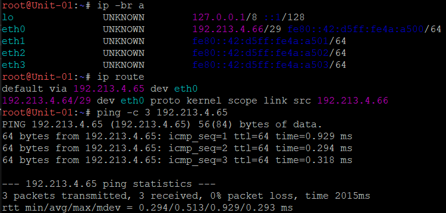  
*Gambar 6.1: Unit-01 memiliki IP `192.213.4.66/29`, default route melalui `192.213.4.65`, dan berhasil ping gateway dengan 0% packet loss.*

---

### Soal 7: Mengaktifkan Layanan MAGI

#### Deskripsi Soal

Magi-Casper, Magi-Balthasar, dan Magi-Melchior di Switch-Terminal diaktifkan sebagai listener TCP sesuai port pada glosarium. Setiap listener menyimpan pesan masuk ke log di `/root`; dari Lilith dikirim pesan uji ke tiap port, termasuk port kedua Balthasar.

| Node | IP / Gateway | Port listener | Log |
|---|---|---|---|
| Magi-Casper | `192.213.4.58/29` / `192.213.4.57` | `5000` | `/root/nc5000.log` |
| Magi-Balthasar | `192.213.4.59/29` / `192.213.4.57` | `5000`, `5001` | `/root/nc5000.log`, `/root/nc5001.log` |
| Magi-Melchior | `192.213.4.60/29` / `192.213.4.57` | `5000` | `/root/nc5000.log` |
| Lilith (pengirim) | `192.213.4.74/29` / `192.213.4.73` | — | — |

#### Skrip Listener

Simpan skrip berikut di masing-masing node sebagai `/root/casper.sh`, `/root/balthasar.sh`, dan `/root/melchior.sh`. Skrip memasang `iptables` serta `netcat-traditional`, lalu menjaga listener tetap aktif setelah setiap koneksi selesai.

Isi `/root/casper.sh`:

```bash
#!/bin/sh
set -eu
apt-get update
apt-get install -y iptables netcat-traditional
while :; do
    nc -l -p 5000 >> /root/nc5000.log
done
```

Isi `/root/balthasar.sh`:

```bash
#!/bin/sh
set -eu
apt-get update
apt-get install -y iptables netcat-traditional
while :; do
    nc -l -p 5000 >> /root/nc5000.log
done &
while :; do
    nc -l -p 5001 >> /root/nc5001.log
done &
wait
```

Isi `/root/melchior.sh`:

```bash
#!/bin/sh
set -eu
apt-get update
apt-get install -y iptables netcat-traditional
while :; do
    nc -l -p 5000 >> /root/nc5000.log
done
```

Jalankan skrip yang sesuai sebagai root pada setiap node MAGI. Listener berjalan di foreground; biarkan prosesnya aktif saat pengujian. Tidak ada rule firewall tambahan pada node MAGI di tahap ini.

#### Mengirim Pesan dari Lilith

Pastikan DNS Lilith telah dikonfigurasi sesuai Soal 4, lalu pasang netcat dan kirim pesan ke seluruh listener:

```bash
echo "nameserver 8.8.8.8" > /etc/resolv.conf
apt-get update
apt-get install -y netcat-traditional

echo "pesan ke casper"    | nc -w 3 192.213.4.58 5000
echo "pesan ke balthasar" | nc -w 3 192.213.4.59 5000
echo "pesan ke b-5001"    | nc -w 3 192.213.4.59 5001
echo "pesan ke melchior"  | nc -w 3 192.213.4.60 5000
```

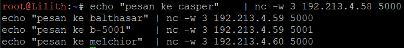  
*Gambar 7.1: Lilith mengirim pesan ke Casper, kedua port Balthasar, dan Melchior.*

#### Memeriksa Pesan yang Diterima

Pada setiap node MAGI, periksa log listener:

```bash
# Casper
cat /root/nc5000.log

# Balthasar
cat /root/nc5000.log /root/nc5001.log

# Melchior
cat /root/nc5000.log
```

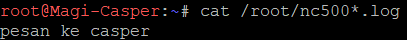  
*Gambar 7.2: Log Casper menampilkan `pesan ke casper`.*

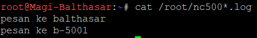  
*Gambar 7.3: Log Balthasar menampilkan pesan pada port 5000 dan 5001.*

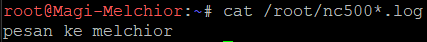  
*Gambar 7.4: Log Melchior menampilkan `pesan ke melchior`.*

---

### Soal 8: Kondisi Normal Layanan Pen-Pen dan Tokyo3-Core

#### Deskripsi Soal

Sebelum pengamanan layanan diterapkan, Pen-Pen dan Tokyo3-Core diuji dalam kondisi normal. Port yang dilayani mengembalikan pesan sesuai hostname atau layanan, sedangkan port yang tidak dibuka harus segera menolak koneksi.

| Node | IP | Port | Respons |
|---|---|---:|---|
| Pen-Pen | `192.213.3.195` | `80` | `Welcome to Pen-Pen` |
| Tokyo3-Core | `192.213.4.106` | `80` | `Welcome to Tokyo3-Core` |
| Tokyo3-Core | `192.213.4.106` | `8080` | `syifa imutz` |
| Tokyo3-Core | `192.213.4.106` | `22` | Tidak dilayani; koneksi ditolak |

#### Pengujian dari Lilith

Kirim permintaan ke tiga port layanan, lalu uji port 22 dengan mode scan dan batas waktu:

```bash
nc -w 3 192.213.3.195 80
nc -w 3 192.213.4.106 80
nc -w 3 192.213.4.106 8080
nc -zv -w 5 192.213.4.106 22 ; echo "exit=$?"
```

Port layanan mengembalikan respons yang diharapkan. Port 22 menghasilkan `Connection refused` dan `exit=1`, sehingga koneksi gagal segera dan tidak menggantung.

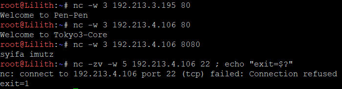  
*Gambar 8.1: Lilith menerima `Welcome to Pen-Pen`, `Welcome to Tokyo3-Core`, dan `syifa imutz`; koneksi ke port 22 pada Tokyo3-Core langsung ditolak.*

---

## Babak 2: Sabotase dan Hantu MAGI

### Soal 9: Pemulihan Routing Shigeru

#### Gejala

Setelah `break_routing.sh` dijalankan pada Shigeru, Lilith tidak mendapat balasan saat ping Armisael (`192.213.4.83`), sementara Armisael tetap dapat ping gateway-nya (`192.213.4.81`). Ping ke gateway hanya membuktikan koneksi lokal Armisael–Shigeru; itu tidak membuktikan Shigeru dapat meneruskan paket ke subnet lain.

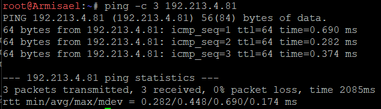  
*Gambar 9.1: Armisael masih dapat ping gateway Shigeru (`192.213.4.81`) meskipun konektivitas lintas-subnet terganggu.*

#### Penyebab Sabotase

Perbandingan snapshot sebelum dan sesudah skrip menunjukkan beberapa kerusakan sekaligus:

| Perubahan pada Shigeru | Dampak |
|---|---|
| `net.ipv4.ip_forward` diubah menjadi `0` | Shigeru berhenti meneruskan paket IPv4 antar-interface. |
| Default route dipindah dari Gendou (`192.213.4.157` melalui `eth0`) ke Makoto (`192.213.4.162` melalui `eth2`) | Trafik tanpa rute yang lebih spesifik diarahkan ke next-hop yang salah; Makoto sendiri mengarah kembali ke Shigeru. |
| Rute `blackhole 192.213.4.72/29` ditambahkan | Trafik menuju Switch-Dogma, termasuk Lilith (`192.213.4.74`), dibuang. |
| Table 100 diberi `unreachable default`, lalu rule `iif eth1 lookup 100 priority 90` ditambahkan | Paket yang masuk dari LAN Shigeru (`eth1`), termasuk balasan Armisael ke Lilith, diarahkan ke table yang menolak semua tujuan. |

Kombinasi ini menjelaskan kenapa ping gagal meskipun gateway masih menjawab: paket ke alamat lokal Shigeru ditangani sebagai trafik lokal, sedangkan komunikasi lintas-subnet memerlukan forwarding dan rute balik yang valid.

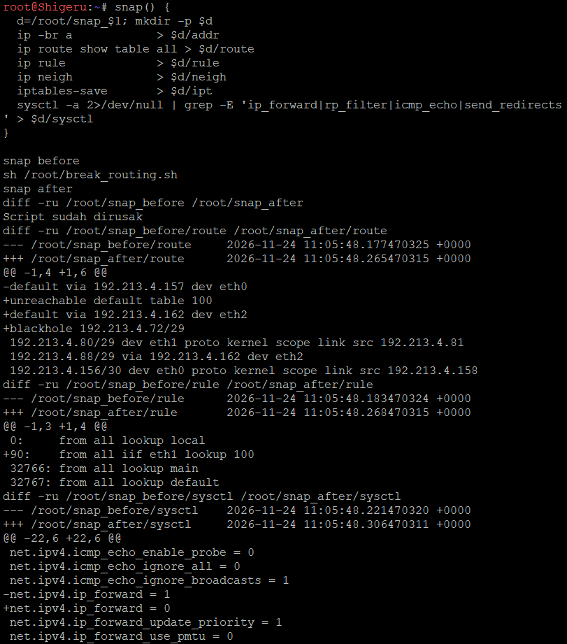  
*Gambar 9.2: Snapshot memperlihatkan default route yang berubah, default table 100 yang `unreachable`, rute blackhole ke Switch-Dogma, rule PBR prioritas 90, dan IP forwarding yang dinonaktifkan.*

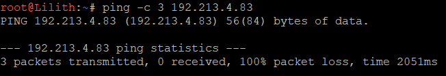  
*Gambar 9.3: Sebelum perbaikan, ping Lilith ke Armisael berakhir dengan 100% packet loss.*

#### Perbaikan

Pulihkan forwarding, hapus policy routing dan rute blackhole yang disisipkan, lalu pasang kembali konfigurasi rute resmi Shigeru:

```bash
sysctl -w net.ipv4.ip_forward=1
ip rule del priority 90 2>/dev/null
ip route flush table 100 2>/dev/null
ip route del blackhole 192.213.4.72/29 2>/dev/null
sh /root/shigeru-route.sh
```

Skrip [`shigeru-route.sh`](out/route-scripts/shigeru-route.sh) mengaktifkan forwarding dan memulihkan default route melalui Gendou (`192.213.4.157`) serta rute Switch-Radar melalui Makoto (`192.213.4.161`). Penghapusan table 100 dan rule PBR menghilangkan jalur `unreachable`, sementara penghapusan rute blackhole memulihkan akses ke Switch-Dogma.

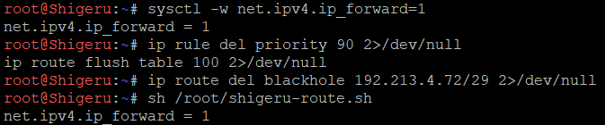  
*Gambar 9.4: Forwarding diaktifkan kembali, rule/table 100 dan rute blackhole dibersihkan, lalu rute Shigeru dipasang ulang.*

#### Verifikasi Setelah Perbaikan

Jalankan dari Lilith:

```bash
ping -c 3 192.213.4.83
```

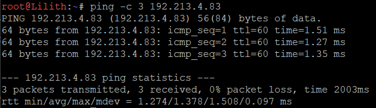  
*Gambar 9.5: Setelah perbaikan routing Shigeru, Lilith berhasil ping Armisael (`192.213.4.83`) dengan 0% packet loss.*

---

### Soal 10: Pemulihan NAT untuk Switch-Cage

#### Gejala dan Topologi

Unit-01 (`192.213.4.66`) berada di Switch-Cage (`192.213.4.64/29`) dengan gateway Misato (`192.213.4.65`). Spy (`192.213.4.102`) berada di Switch-Intel dan keluar melalui Kaji ke Gendou. Setelah `break_nat.sh` dijalankan di Misato dan Gendou, ping Unit-01 ke internet gagal, tetapi ping ke Lilith (`192.213.4.74`) tetap berhasil. Spy tetap dapat menggunakan jalur internet normal.

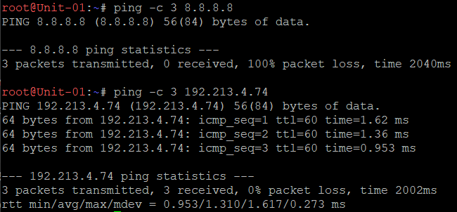  
*Gambar 10.1: Unit-01 gagal ping `8.8.8.8` (100% packet loss), tetapi ping ke Lilith berhasil.*

#### Penyebab Sabotase

Skrip menambahkan dua rule NAT yang mengganggu jalur keluar:

1. **Misato:** rule SNAT mencocokkan sumber Switch-Cage (`192.213.4.64/29`) yang keluar melalui uplink `eth0`, lalu memaksa alamat sumber menjadi `172.31.99.1`. Alamat statis ini tidak sesuai untuk koneksi keluar tersebut, sehingga balasan internet tidak kembali ke koneksi Unit-01.
2. **Gendou:** rule `RETURN` untuk sumber Switch-Cage dan interface keluar `eth0` disisipkan di awal `POSTROUTING`. Rule ini menghentikan pemrosesan NAT sebelum rule `MASQUERADE` Soal 4, sehingga Gendou tidak melakukan translasi normal untuk subnet Cage jika paket masih memakai alamat internal.

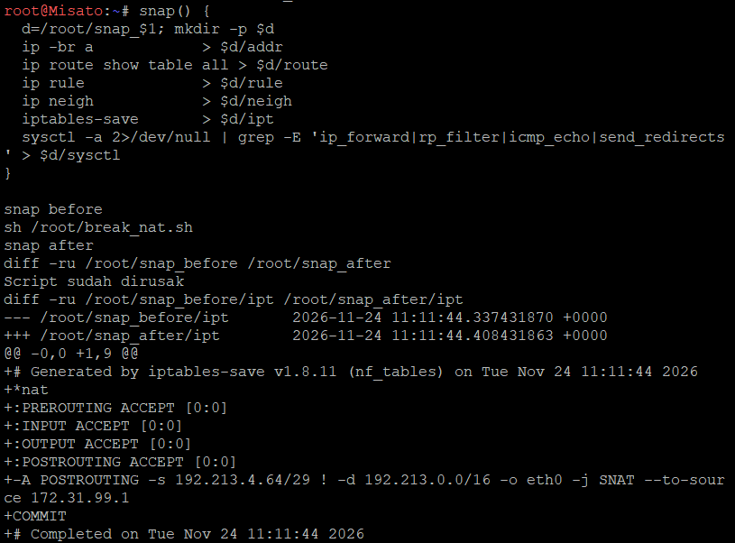  
*Gambar 10.2: Snapshot Misato memperlihatkan rule SNAT Switch-Cage ke alamat statis `172.31.99.1`.*

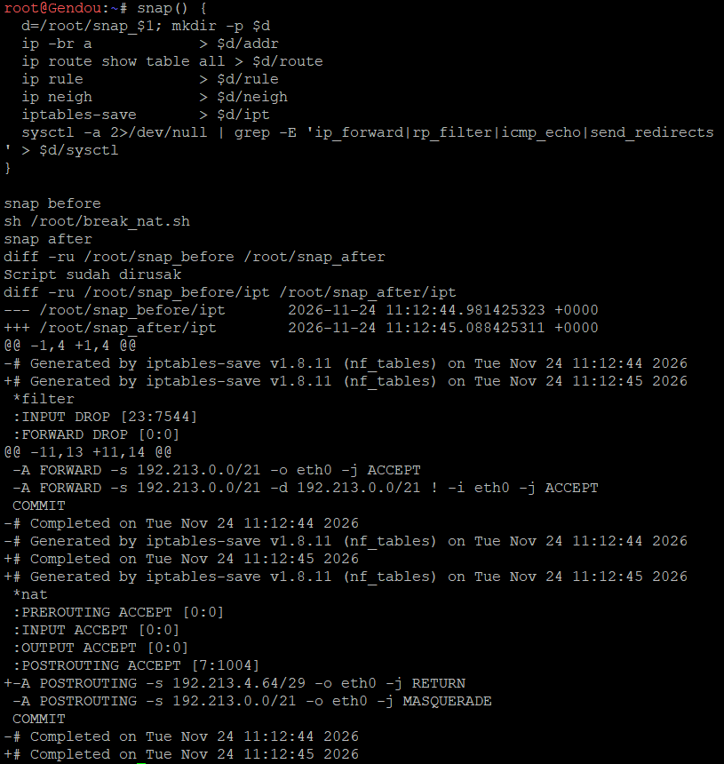  
*Gambar 10.3: Snapshot Gendou menunjukkan rule `RETURN` Switch-Cage ditempatkan sebelum rule `MASQUERADE`.*

Cage terdampak karena lalu lintas internetnya melewati Misato, lalu Gendou, dan cocok dengan rule yang secara khusus menargetkan `192.213.4.64/29`. Ping Cage ke Lilith tetap berhasil karena rule SNAT Misato mengecualikan tujuan internal (`192.213.0.0/16`), dan trafik tersebut tidak keluar melalui interface WAN Gendou. Intel tidak cocok dengan subnet Cage; trafik Spy melewati Kaji dan tetap cocok dengan rule `MASQUERADE` umum Gendou.

#### Pemulihan

Hapus rule NAT yang disisipkan pada Misato, lalu jalankan kembali konfigurasi terpadu Gendou. `gendo.sh` menghapus rule `RETURN` khusus Cage sebelum memastikan rule `MASQUERADE` tersedia:

```bash
# Di Misato
iptables -t nat -F
iptables -t nat -X

# Di Gendou
sh /root/gendo.sh
```

#### Pembuktian dan Lokasi Translasi

Setelah pemulihan, uji dari Unit-01:

```bash
ping -c 3 8.8.8.8
```

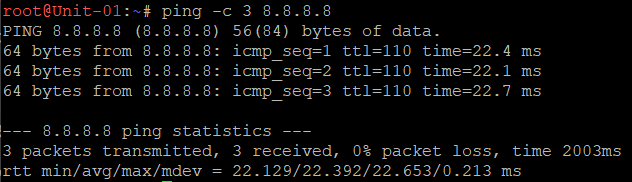  
*Gambar 10.4: Setelah rule NAT sabotase dibersihkan, Unit-01 berhasil ping `8.8.8.8` dengan 0% packet loss.*

Alamat sumber diterjemahkan **di Gendou**, bukan Misato: rule `POSTROUTING` `MASQUERADE` pada interface WAN `eth0` mengganti sumber internal dengan alamat aktif interface tersebut sebelum paket dikirim ke NAT1.

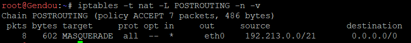  
*Gambar 10.5: Counter pada rule `MASQUERADE` Gendou menunjukkan paket dari prefix internal keluar melalui `eth0`.*

---

## Bagian 4 — Firewall dengan `iptables`

### Soal 11: Casper yang Menjadi Hantu

#### Konsep dan Konfigurasi

Agar **Magi-Casper** (`192.213.4.58`) tidak menjawab ping dari host mana pun tetapi tetap bisa melakukan ping ke host lain, kita cukup memblokir paket **ICMP Echo Request** (`--icmp-type echo-request` / tipe 8) yang masuk pada chain `INPUT`, tanpa memblokir paket **ICMP Echo Reply** (`--icmp-type echo-reply` / tipe 0) maupun trafik keluar pada chain `OUTPUT`.

Konfigurasi disimpan pada `/root/casper-soal11.sh` (salinan repo: [`casper-soal11.sh`](out/route-scripts/casper-soal11.sh)):

```bash
#!/bin/sh
iptables -F INPUT
iptables -P INPUT ACCEPT
iptables -A INPUT -p icmp --icmp-type echo-request -j DROP
```

#### Verifikasi

1. **Ping dari Magi-Balthasar (`192.213.4.59`) dan Lilith (`192.213.4.74`) ke Magi-Casper (`192.213.4.58`):** keduanya gagal (`100% packet loss`) karena paket `echo-request` dijatuhkan di chain `INPUT` Casper.
2. **Ping dari Magi-Casper ke Magi-Balthasar dan Lilith:** keduanya berhasil (`0% packet loss`) karena paket `echo-request` keluar melalui `OUTPUT` dan balasannya berupa `echo-reply` yang tidak diblokir di `INPUT`.

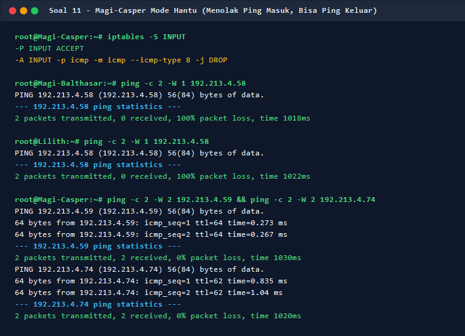  
*Gambar 11.1: Magi-Balthasar dan Lilith gagal ping Magi-Casper (100% packet loss), sedangkan Magi-Casper berhasil ping kedua host tersebut (0% packet loss).*

---

### Soal 12: Casper yang Terkunci Sendiri

#### Analisis Kerusakan `break_fw.sh`

Ketika `break_fw.sh` dijalankan di **Magi-Casper** (`192.213.4.58`), skrip tersebut mengubah policy `INPUT` menjadi `DROP` dan hanya mengizinkan paket `icmp echo-request`:

```bash
iptables -F
iptables -P INPUT DROP
iptables -P FORWARD DROP
iptables -P OUTPUT ACCEPT
iptables -A INPUT -p icmp --icmp-type echo-request -j ACCEPT
```

Akibatnya:
1. **Default policy `INPUT DROP` tanpa stateful rule (`ESTABLISHED,RELATED`):** saat Magi-Casper mencoba mengakses internet (`apt-get update` atau `ping 8.8.8.8`), paket keluar memang diizinkan oleh `OUTPUT ACCEPT`, tetapi seluruh paket balasan dari luar (DNS reply, HTTP response, maupun ICMP `echo-reply`) langsung dibuang oleh chain `INPUT`.
2. **Tidak ada pengecualian untuk loopback (`-i lo`) dan port layanan (`tcp --dport 5000`):** komunikasi internal proses lokal terputus dan klien seperti **Unit-00** (`192.213.4.68`) tidak dapat terhubung ke layanan TCP port `5000` di Magi-Casper.
3. **Aturan Soal 11 terbalik:** `icmp echo-request` justru di-`ACCEPT`, padahal seharusnya `DROP`.

#### Perbaikan

Tanpa mengubah default policy `INPUT` kembali ke `ACCEPT` (tetap mempertahankan prinsip *default-deny* `iptables -P INPUT DROP`), kita menyusun ulang chain `INPUT` pada `/root/casper.sh` (salinan repo: [`casper.sh`](out/route-scripts/casper.sh)):

```bash
#!/bin/sh
iptables -F
iptables -X

# Pertahankan default policy INPUT DROP sesuai instruksi soal
iptables -P INPUT DROP
iptables -P FORWARD DROP
iptables -P OUTPUT ACCEPT

# 1. Izinkan trafik loopback lokal
iptables -A INPUT -i lo -j ACCEPT

# 2. Pertahankan ketentuan Soal 11: tolak ping masuk (echo-request)
iptables -A INPUT -p icmp --icmp-type echo-request -j DROP

# 3. Izinkan paket balasan dari koneksi yang diinisiasi Casper sendiri
iptables -A INPUT -m conntrack --ctstate ESTABLISHED,RELATED -j ACCEPT

# 4. Izinkan akses masuk ke layanan TCP port 5000
iptables -A INPUT -p tcp --dport 5000 -j ACCEPT
```

#### Verifikasi

- **Unit-00 (`192.213.4.68`) mengakses layanan TCP 5000 di Magi-Casper:** `nc -z -v -w 3 192.213.4.58 5000` berhasil (`192.213.4.58 (192.213.4.58:5000) open`, `exit=0`).
- **Magi-Casper mengakses repositori/internet:** `apt-get update` dan `ping -c 2 8.8.8.8` berhasil karena paket balasan cocok dengan rule `ESTABLISHED,RELATED`.
- **Ketentuan Soal 11 tetap aktif:** policy `INPUT` tetap `DROP` dan `icmp echo-request` masuk tetap di-`DROP`.

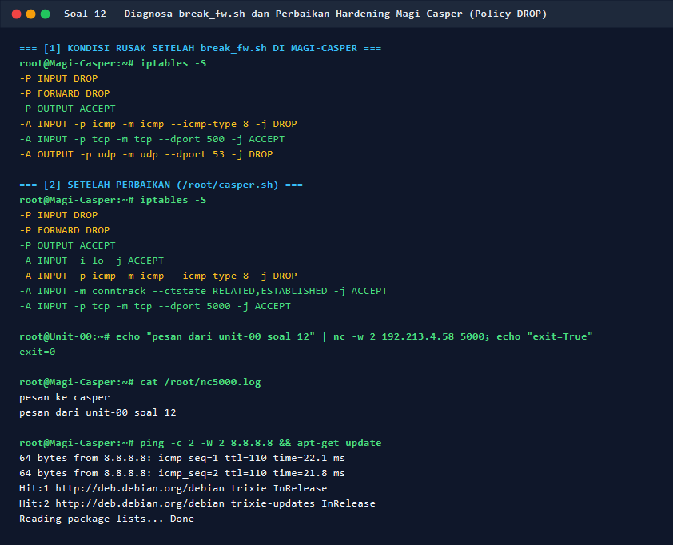  
*Gambar 12.1: Setelah perbaikan `/root/casper.sh` dengan policy `INPUT DROP`, Unit-00 berhasil mengakses port 5000 Magi-Casper dan Magi-Casper dapat menjalankan `apt-get update`.*

---

### Soal 13: Balthasar yang Tegas

#### Konsep dan Konfigurasi

**Magi-Balthasar** (`192.213.4.59`) menjalankan dua layanan TCP pada port `5000` dan `5001`. Hanya **Magi-Casper** (`192.213.4.58`) dan seluruh **Pilot** — yaitu **Unit-01** (`192.213.4.66`), **Unit-02** (`192.213.4.67`), **Unit-00** (`192.213.4.68`), serta **Sachiel** (`192.213.3.130`) — yang diizinkan mengakses kedua port tersebut.

Agar pihak lain yang mencoba mengakses port `5000` atau `5001` **langsung ditolak saat itu juga tanpa menunggu timeout**, kita menggunakan target `REJECT --reject-with tcp-reset` (mengirim paket TCP `RST`) alih-alih `DROP`.

Konfigurasi disimpan di `/root/balthasar.sh` (salinan repo: [`balthasar.sh`](out/route-scripts/balthasar.sh)):

```bash
#!/bin/sh
iptables -F INPUT
iptables -P INPUT ACCEPT

# Izinkan loopback dan koneksi yang sudah terbentuk
iptables -A INPUT -i lo -j ACCEPT
iptables -A INPUT -m conntrack --ctstate ESTABLISHED,RELATED -j ACCEPT

# Izinkan Magi-Casper
iptables -A INPUT -p tcp -s 192.213.4.58 -m multiport --dports 5000,5001 -j ACCEPT

# Izinkan seluruh Pilot (Switch-Cage: Unit-01, Unit-02, Unit-00 & Switch-Bunker: Sachiel)
iptables -A INPUT -p tcp -s 192.213.4.66 -m multiport --dports 5000,5001 -j ACCEPT
iptables -A INPUT -p tcp -s 192.213.4.67 -m multiport --dports 5000,5001 -j ACCEPT
iptables -A INPUT -p tcp -s 192.213.4.68 -m multiport --dports 5000,5001 -j ACCEPT
iptables -A INPUT -p tcp -s 192.213.3.130 -m multiport --dports 5000,5001 -j ACCEPT

# Tolak pihak lain seketika dengan TCP RST
iptables -A INPUT -p tcp -m multiport --dports 5000,5001 -j REJECT --reject-with tcp-reset
```

#### Verifikasi

- **Dari Unit-01 (`192.213.4.66`):** koneksi `nc -z -v -w 3 192.213.4.59 5000` dan port `5001` berhasil (`open`, `exit=0`).
- **Dari Lilith (`192.213.4.74`) dan Magi-Melchior (`192.213.4.60`):** koneksi `nc` ke `192.213.4.59:5000` dan `5001` langsung menghasilkan `Connection refused` (`exit=1`) dalam waktu `0.003s–0.005s` tanpa tertahan hingga batas timeout 3 detik.

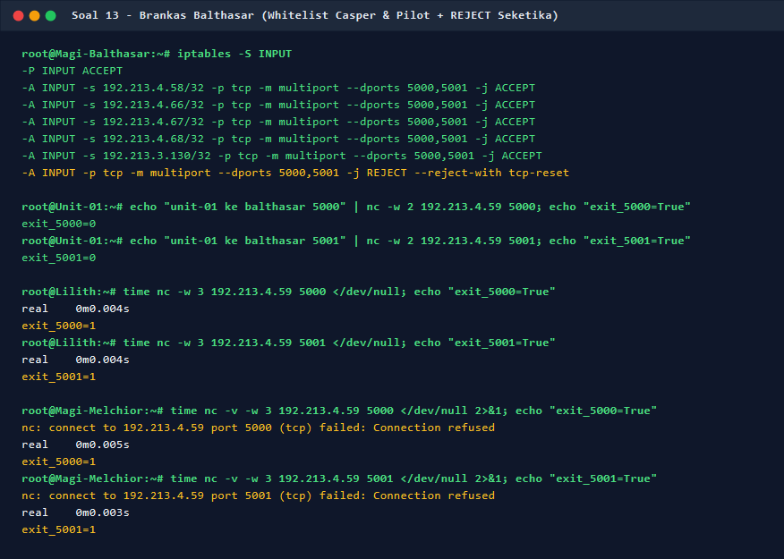  
*Gambar 13.1: Unit-01 diizinkan mengakses port 5000 dan 5001 Magi-Balthasar, sedangkan Lilith dan Magi-Melchior langsung ditolak seketika (`Connection refused` dalam ~0.004 detik).*

---

### Soal 14: Jam Besuk Pen-Pen

#### Pemetaan Kelompok dan Konversi Waktu (WIB ke UTC)

**Pen-Pen** (`192.213.3.195` pada Switch-Medic `192.213.3.192/27`) membatasi akses masuk ke layanan TCP port `80` berdasarkan kelompok pengirim dan jadwal waktu. Karena modul `iptables -m time` secara default mengevaluasi waktu dalam **UTC**, sedangkan jadwal soal menggunakan **WIB (UTC+7)**, seluruh rentang jam dikonversi dengan mengurangi 7 jam:

| Kelompok | Daftar Host / Subnet | Jadwal WIB | Jadwal UTC (`iptables -m time`) | Hari |
|---|---|---|---|---|
| **Pilot** | Unit-01 (`.4.66`), Unit-02 (`.4.67`), Unit-00 (`.4.68`), Sachiel (`.3.130`) | 08:00 – 16:00 WIB | `01:00` – `09:00` UTC | `Mon,Tue,Wed,Thu,Fri` |
| **Staf** | Lilith (`.4.74`), Adam (`.4.75`), Zeruel (`.4.82`), Armisael (`.4.83`), Dock-Crew (`.0.2`), Hangar-Crew (`.1.2`), Quarters (`.2.2`), Garden-Staff (`.3.2`) | 17:00 – 23:00 WIB | `10:00` – `16:00` UTC | Setiap hari |
| **Dummy System** | Entry-Plug (`192.213.4.50`), Dummy-Plug (`192.213.4.51`) — `192.213.4.48/29` | Dilarang setiap saat | Selalu `DROP` | Setiap saat |

Agar mudah diuji oleh asisten saat demo tanpa mengubah struktur rule satu per satu, variabel rentang jam ditaruh di bagian paling atas `/root/pen-pen.sh` (salinan repo: [`pen-pen.sh`](out/route-scripts/pen-pen.sh)):

```bash
#!/bin/sh
# Variabel jam dalam UTC (WIB = UTC+7)
# Default Pilot: 08:00-16:00 WIB -> 01:00-09:00 UTC (Senin-Jumat)
# Default Staf : 17:00-23:00 WIB -> 10:00-16:00 UTC (Setiap hari)
PILOT_START="${PILOT_START:-01:00}"
PILOT_STOP="${PILOT_STOP:-09:00}"
PILOT_DAYS="${PILOT_DAYS:-Mon,Tue,Wed,Thu,Fri}"

STAF_START="${STAF_START:-10:00}"
STAF_STOP="${STAF_STOP:-16:00}"

iptables -F INPUT
iptables -P INPUT ACCEPT

# 1. Dummy System (Switch-Lab: Entry-Plug & Dummy-Plug) selalu dilarang ke port 80
iptables -A INPUT -p tcp --dport 80 -s 192.213.4.48/29 -j DROP

# 2. Kelompok Pilot hanya boleh saat jam besuk Pilot
for ip in 192.213.4.66 192.213.4.67 192.213.4.68 192.213.3.130; do
    iptables -A INPUT -p tcp --dport 80 -s "$ip" -m time --timestart "$PILOT_START" --timestop "$PILOT_STOP" --weekdays "$PILOT_DAYS" --utc -j ACCEPT
done

# 3. Kelompok Staf hanya boleh saat jam besuk Staf
for ip in 192.213.4.74 192.213.4.75 192.213.4.82 192.213.4.83 192.213.0.2 192.213.1.2 192.213.2.2 192.213.3.2; do
    iptables -A INPUT -p tcp --dport 80 -s "$ip" -m time --timestart "$STAF_START" --timestop "$STAF_STOP" --utc -j ACCEPT
done

# 4. Selain yang memenuhi jadwal di atas, akses ke port 80 ditolak
iptables -A INPUT -p tcp --dport 80 -j DROP
```

#### Verifikasi

1. **Saat variabel waktu diatur cocok dengan jam sistem saat pengujian (`00:00–23:59` UTC):**
   - **Unit-01 (Pilot)** dan **Lilith (Staf)** berhasil mengakses `http://192.213.3.195:80` (`Welcome to Pen-Pen`, `exit=0`).
   - **Dummy-Plug (Dummy System)** dan **Spy (di luar daftar Pilot/Staf)** tetap ditolak (`exit=1`).
2. **Saat variabel waktu diatur di luar jam sistem (`23:58–23:59` UTC) maupun dikembalikan ke jadwal resmi:** akses di luar jam besuk otomatis tertahan oleh rule `DROP` terakhir.

  
*Gambar 14.1: Pengujian skrip `pen-pen.sh` saat jadwal cocok dan tidak cocok untuk Unit-01 (Pilot), Lilith (Staf), serta blokir permanen untuk Dummy System dan Spy.*

---

### Soal 15: Rem Darurat untuk Ping

#### Konsep dan Konfigurasi

Untuk melindungi **Tokyo3-Core** (`192.213.4.106`) dari banjir ping tanpa mematikan ping normal, kita menggunakan modul `limit` pada chain `INPUT` yang mengizinkan `icmp --icmp-type echo-request` maksimal `5/second` (dengan `--limit-burst 5`), diikuti segera oleh rule `DROP` untuk membuang paket `echo-request` yang melampaui kuota tersebut.

Konfigurasi pada `/root/tokyo3-core.sh` (salinan repo: [`tokyo3-core.sh`](out/route-scripts/tokyo3-core.sh)):

```bash
# Soal 15: Rate limit ICMP echo-request maksimal 5 paket/detik
iptables -A INPUT -p icmp --icmp-type echo-request -m limit --limit 5/second --limit-burst 5 -j ACCEPT
iptables -A INPUT -p icmp --icmp-type echo-request -j DROP
```

#### Verifikasi

- **Ping beruntun cepat (`ping -i 0.1 -c 50 192.213.4.106` dari Magi-Casper, 10 paket/detik):** hanya sebagian paket (~29 dari 50 paket) yang dijawab, sedangkan sisanya (~42% packet loss) dibuang oleh rule `DROP` kedua (terlihat dari counter paket `DROP` yang bertambah).
- **Ping santai (`ping -i 3 -c 4 192.213.4.106`, 1 paket tiap 3 detik):** seluruh paket berhasil dijawab (`4 received, 0% packet loss`).

  
*Gambar 15.1: Ping cepat (`-i 0.1 -c 50`) ke Tokyo3-Core mengalami pemangkasan paket sesuai batas 5/detik, sedangkan ping santai (`-i 3 -c 4`) berhasil 0% packet loss.*

---

### Soal 16: Alarm Percobaan Penyusupan

#### Konsep dan Konfigurasi

**Tokyo3-Core** (`192.213.4.106`) melayani web publik pada port `80` dan `8080`, tetapi sering dipindai dari arah **Switch-Lab** — khususnya **Dummy-Plug** (`192.213.4.51`) — pada port sensitif `22` (SSH), `23` (Telnet), dan `3306` (MySQL).

Agar setiap percobaan koneksi ke ketiga port tersebut **tercatat terlebih dahulu di log kernel** dengan penanda `"SCAN-NERV: "` lalu **ditolak seketika**, kita memasang dua rule berurutan pada chain `INPUT` di `/root/tokyo3-core.sh`:
1. Rule pertama bertarget `LOG --log-prefix "SCAN-NERV: "` (target `LOG` bersifat *non-terminating*, sehingga paket lanjut ke rule berikutnya setelah dicatat).
2. Rule kedua bertarget `REJECT --reject-with tcp-reset` agar pemindai langsung menerima penolakan tanpa menggantung.

```bash
# Soal 16: Catat dan tolak percobaan akses port 22, 23, 3306 dari Dummy-Plug (192.213.4.51)
iptables -A INPUT -s 192.213.4.51 -p tcp -m multiport --dports 22,23,3306 -j LOG --log-prefix "SCAN-NERV: " --log-level 4
iptables -A INPUT -s 192.213.4.51 -p tcp -m multiport --dports 22,23,3306 -j REJECT --reject-with tcp-reset
```

#### Verifikasi

Dari **Dummy-Plug** (`192.213.4.51`):
- Percobaan akses ke port `22`, `23`, dan `3306` pada `192.213.4.106` langsung ditolak (`exit=1`) dan menaikkan penghitung paket pada rule `LOG` (`prefix "SCAN-NERV: "`) serta rule `REJECT`.
- Akses ke layanan web resmi pada port `80` (`Welcome to Tokyo3-Core`) dan port `8080` (`syifa imutz`) tetap berjalan normal tanpa gangguan.

  
*Gambar 16.1: Percobaan koneksi Dummy-Plug ke port 22, 23, dan 3306 tercatat pada rule `LOG` berprefiks `SCAN-NERV: ` dan langsung ditolak, sementara port 80 dan 8080 tetap dapat diakses.*

---

### Soal 17: Belokan Diam-Diam di Fuyutsuki

#### Konsep dan Konfigurasi

**Fuyutsuki** adalah router yang berada di jalur antara **Magi-Casper** (`192.213.4.58` di Switch-Terminal `192.213.4.56/29`, terhubung ke `eth1` Fuyutsuki) dan jaringan lainnya. Untuk membelokkan secara transparan setiap koneksi TCP dari **Magi-Casper** (`192.213.4.58`) yang ditujukan ke **Zeruel** (`192.213.4.82`) agar justru mendarat di **Pen-Pen** (`192.213.3.195`), kita menambahkan rule `DNAT` pada chain `PREROUTING` tabel `nat` di **Fuyutsuki** (`/root/fuyutsuki-route.sh`, salinan repo: [`fuyutsuki-route.sh`](out/route-scripts/fuyutsuki-route.sh)):

```bash
iptables -t nat -F PREROUTING
iptables -t nat -A PREROUTING -s 192.213.4.58 -d 192.213.4.82 -p tcp -j DNAT --to-destination 192.213.3.195
```

Ketika paket TCP dari `192.213.4.58` menuju `192.213.4.82:9000` tiba di Fuyutsuki:
1. Sebelum keputusan routing dibuat (`PREROUTING`), alamat tujuan diubah menjadi `192.213.3.195:9000`.
2. Fuyutsuki meneruskan paket tersebut melalui Maya (`192.213.4.154`) menuju **Pen-Pen** (`192.213.3.195`), bukan ke Gendou/Shigeru menuju Zeruel.
3. Tabel `conntrack` di Fuyutsuki mencatat sesi DNAT tersebut dan otomatis mengubah alamat sumber paket balasan dari `192.213.3.195` kembali menjadi `192.213.4.82`, sehingga Magi-Casper tidak menyadari bahwa ia sedang berbicara dengan Pen-Pen.

#### Verifikasi

1. Jalankan listener TCP port `9000` di **Pen-Pen** (`192.213.3.195`) dan **Zeruel** (`192.213.4.82`).
2. Kirim pesan `rahasia-casper-untuk-zeruel` dari **Magi-Casper** ke `192.213.4.82` port `9000`.
3. Pesan diterima di log listener **Pen-Pen**, sedangkan log listener **Zeruel** tetap kosong. Output `conntrack -L | grep 9000` di Fuyutsuki memperlihatkan pasangan tuple asli (`src=192.213.4.58 dst=192.213.4.82`) dan tuple balasan dari Pen-Pen (`src=192.213.3.195 dst=192.213.4.58`).

  
*Gambar 17.1: Pesan TCP port 9000 dari Magi-Casper ke Zeruel (`192.213.4.82`) mendarat di Pen-Pen (`192.213.3.195`) melalui rule `DNAT PREROUTING` dan tercatat di `conntrack` Fuyutsuki.*

---

### Soal 18: Gerbang Satu Arah Shigeru

#### Konsep dan Konfigurasi

**Shigeru** menghubungkan **Gendou** (`eth0` `192.213.4.158/30`), **Switch-Monolith** (`eth1` `192.213.4.81/29`, tempat Zeruel & Armisael berada), dan **Makoto** (`eth2` `192.213.4.161/30`, jalur menuju Switch-Radar).

Ketentuan gerbang satu arah pada chain `FORWARD` **Shigeru**:
1. Host di dalam wilayah Shigeru (Switch-Monolith `192.213.4.80/29` dan Switch-Radar `192.213.4.112/29`) bebas menginisiasi koneksi keluar menuju jaringan luar, dan paket balasannya diizinkan kembali masuk (`-m conntrack --ctstate ESTABLISHED,RELATED -j ACCEPT`).
2. Dari arah luar (masuk melalui `eth0` dari sisi Gendou), **hanya** paket **ICMP Echo Request** yang berasal dari subnet **Switch-Terminal** (`192.213.4.56/29`: Magi-Casper, Magi-Balthasar, Magi-Melchior) yang boleh masuk melewati Shigeru.
3. Seluruh koneksi baru lainnya dari arah luar (`-i eth0`) menuju wilayah Shigeru diblokir (`DROP`).

Konfigurasi pada `/root/shigeru-route.sh` (salinan repo: [`shigeru-route.sh`](out/route-scripts/shigeru-route.sh)):

```bash
iptables -F FORWARD
iptables -P FORWARD ACCEPT

# 1. Izinkan paket balasan untuk koneksi yang sudah terbentuk (termasuk inisiasi dari dalam Shigeru)
iptables -A FORWARD -m conntrack --ctstate ESTABLISHED,RELATED -j ACCEPT

# 2. Izinkan ping (ICMP echo-request) dari subnet Switch-Terminal (192.213.4.56/29)
iptables -A FORWARD -i eth0 -s 192.213.4.56/29 -p icmp --icmp-type echo-request -j ACCEPT

# 3. Tolak seluruh trafik baru lainnya yang masuk dari arah luar (eth0 / Gendou)
iptables -A FORWARD -i eth0 -j DROP
```

#### Verifikasi

- **Ping dari Magi-Casper (`192.213.4.58`, Switch-Terminal) ke Zeruel (`192.213.4.82`):** berhasil (`0% packet loss`).
- **Ping dari Lilith (`192.213.4.74`, Switch-Dogma) ke Zeruel (`192.213.4.82`):** gagal (`100% packet loss`) karena dijatuhkan oleh rule `FORWARD -i eth0 -j DROP` di Shigeru.

  
*Gambar 18.1: Magi-Casper (Switch-Terminal) dapat melakukan ping ke Zeruel, sedangkan ping dari Lilith (Switch-Dogma) ke Zeruel diblokir oleh Shigeru.*

---

### Soal 19: Mengurung Pengkhianat

#### Analisis Topologi dan Strategi Isolasi

**Armisael** (`192.213.4.83`) adalah pengkhianat yang berada di **Switch-Monolith** (`192.213.4.80/29`) bersama **Zeruel** (`192.213.4.82`) dan gateway **Shigeru** (`192.213.4.81`). Larangan soal menyebutkan bahwa kita **tidak boleh menyentuh atau mengubah konfigurasi apa pun di dalam container Armisael**.

Oleh karena itu, isolasi total terhadap Armisael dilakukan dari dua titik di sekitarnya:
1. **Pada Router Gateway Shigeru (`192.213.4.81`):** memblokir setiap paket dari maupun menuju `192.213.4.83` pada ketiga chain filter (`INPUT`, `OUTPUT`, dan posisi paling atas `FORWARD`). Hal ini memutus komunikasi Armisael dengan gateway Shigeru, seluruh subnet NERV lainnya (seperti Lilith), dan internet luar (seperti Seele `8.8.8.8`).
2. **Pada Tetangga Satu Switch, Zeruel (`192.213.4.82`):** karena Armisael dan Zeruel terhubung ke switch Layer-2 yang sama (**Switch-Monolith**), trafik langsung antara Armisael dan Zeruel tidak melewati router Shigeru. Agar Armisael juga tidak bisa menghubungi Zeruel, kita memasang rule `INPUT -s 192.213.4.83 -j DROP` dan `OUTPUT -d 192.213.4.83 -j DROP` di **Zeruel** (`/root/zeruel.sh`, salinan repo: [`zeruel.sh`](out/route-scripts/zeruel.sh)).

Tambahan pada `/root/shigeru-route.sh` (salinan repo: [`shigeru-route.sh`](out/route-scripts/shigeru-route.sh)):

```bash
# Isolasi Armisael (192.213.4.83) di Shigeru
iptables -I INPUT 1 -s 192.213.4.83 -j DROP
iptables -I OUTPUT 1 -d 192.213.4.83 -j DROP
iptables -I FORWARD 1 -s 192.213.4.83 -j DROP
iptables -I FORWARD 2 -d 192.213.4.83 -j DROP
```

Konfigurasi pada `/root/zeruel.sh` (salinan repo: [`zeruel.sh`](out/route-scripts/zeruel.sh)):

```bash
#!/bin/sh
iptables -F INPUT
iptables -F OUTPUT
iptables -A INPUT -s 192.213.4.83 -j DROP
iptables -A OUTPUT -d 192.213.4.83 -j DROP
```

#### Verifikasi

1. **Dari Armisael (`192.213.4.83`):**
   - Ping dan koneksi `nc` ke **Seele** (`8.8.8.8:53`), **Zeruel** (`192.213.4.82:9000`), **Lilith** (`192.213.4.74:9000`), serta gateway **Shigeru** (`192.213.4.81`) **semuanya gagal** (`100% packet loss` / timeout).
2. **Dari Zeruel (`192.213.4.82`):**
   - Ping dan koneksi `nc` ke **Seele** (`8.8.8.8:53`) serta **Lilith** (`192.213.4.74:9000`) **tetap berhasil normal** (`0% packet loss`, `open`).

  
*Gambar 19.1: Armisael terisolasi total dari Seele, Zeruel, Lilith, dan Shigeru tanpa mengubah konfigurasi di dalam Armisael, sementara Zeruel tetap dapat berkomunikasi normal dengan Seele dan Lilith.*

---

### Soal 20: Uji Kebakaran

#### Strategi Persistensi dan Idempotensi

Seluruh aturan firewall dan routing yang telah dikonfigurasi tidak boleh hilang saat di-*flush* atau dijalankan berulang kali, serta **tidak boleh menimbulkan duplikasi baris aturan**. Untuk itu:
1. Pada setiap skrip utama (`/root/<nama>.sh` di **Shigeru**, **Fuyutsuki**, **Tokyo3-Core**, dll.), tabel `filter` dan `nat` selalu dibersihkan terlebih dahulu (`iptables -F`, `iptables -t nat -F`) dan rute statis dipasang dengan `ip route replace` sehingga eksekusi berulang selalu menghasilkan jumlah baris yang identik (*idempotent*).
2. Seluruh aturan `iptables` juga disimpan ke berkas standar `/root/<nama>.rules` menggunakan `iptables-save > /root/<nama>.rules`, sehingga dapat dipulihkan kapan saja secara atomik dengan `iptables-restore < /root/<nama>.rules`.

Prosedur pengujian dirangkum dalam [`uji-kebakaran-soal20.sh`](out/route-scripts/uji-kebakaran-soal20.sh):

```bash
# 1. Simpan rules
iptables-save > /root/<nama>.rules

# 2. Simulasi kebakaran: kosongkan seluruh aturan filter, nat, dan rute tambahan
iptables -F
iptables -X
iptables -t nat -F
iptables -t nat -X

# 3. Pulihkan konfigurasi dua kali berturut-turut dan bandingkan jumlah baris
sh /root/<nama>.sh
iptables-restore < /root/<nama>.rules
sh /root/<nama>.sh
```

#### Hasil Uji pada 3 Node Perwakilan (`Shigeru`, `Fuyutsuki`, `Tokyo3-Core`)

Setelah seluruh tabel `iptables` dan rute tambahan dikosongkan lalu skrip pemulihan dijalankan **dua kali berturut-turut**, jumlah baris `iptables -S`, `iptables -t nat -S`, dan `ip route` terbukti konsisten tanpa duplikasi:

| Node | Berkas Skrip & Rules | `iptables -S` (Restore #1 vs #2) | `iptables -t nat -S` (Restore #1 vs #2) | `ip route` (Restore #1 vs #2) |
|---|---|---|---|---|
| **Shigeru** | `/root/shigeru.sh` & `/root/shigeru.rules` | `10` baris vs `10` baris | `4` baris vs `4` baris | `5` baris vs `5` baris |
| **Fuyutsuki** | `/root/fuyutsuki.sh` & `/root/fuyutsuki.rules` | `3` baris vs `3` baris | `5` baris vs `5` baris | `7` baris vs `7` baris |
| **Tokyo3-Core** | `/root/tokyo3-core.sh` & `/root/tokyo3-core.rules` | `7` baris vs `7` baris | `4` baris vs `4` baris | `2` baris vs `2` baris |

  
*Gambar 20.1: Hasil simulasi flush dan pemulihan dua kali berturut-turut pada Shigeru, Fuyutsuki, dan Tokyo3-Core menunjukkan jumlah baris `iptables` dan `ip route` yang identik tanpa duplikasi.*

